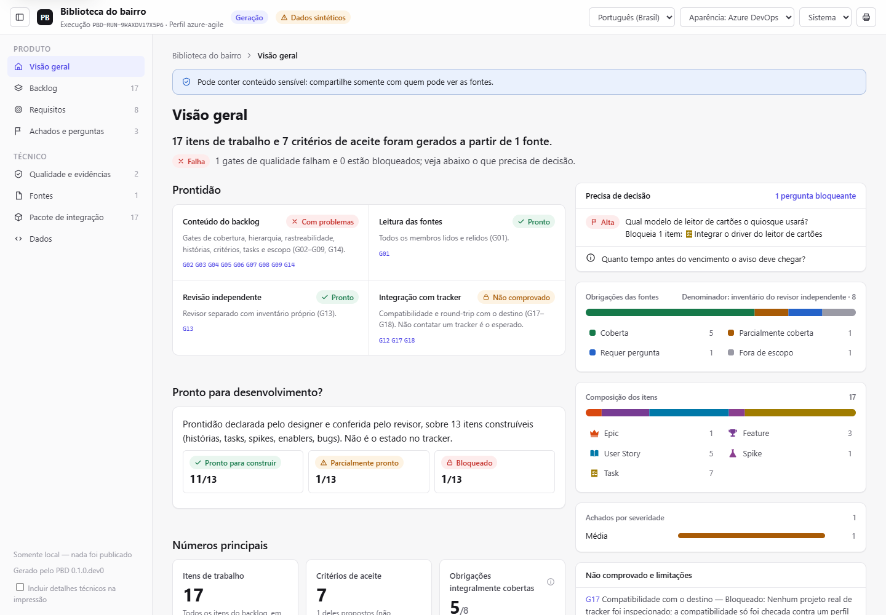
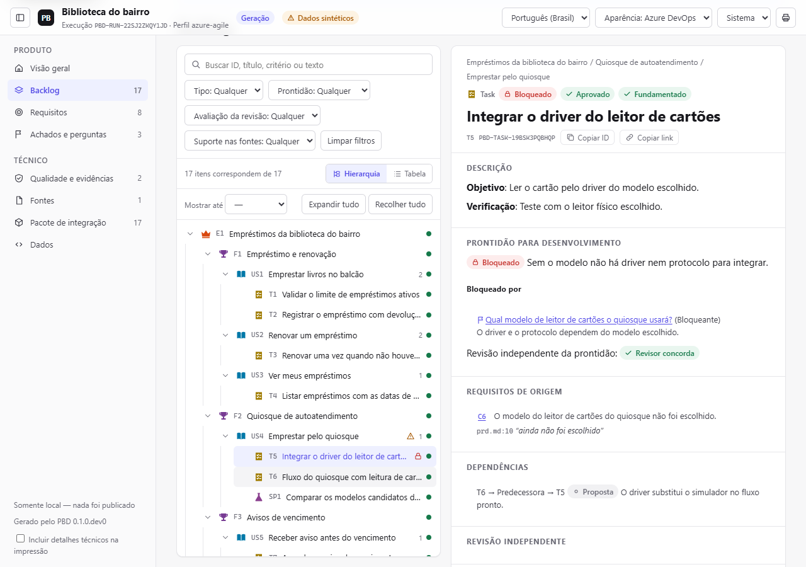
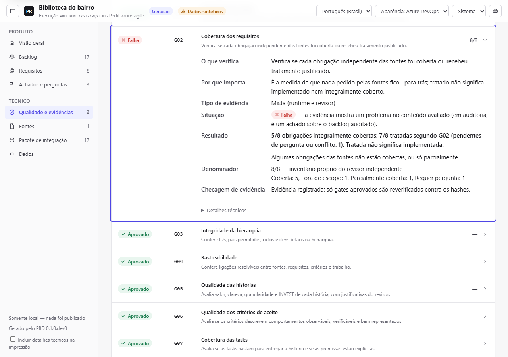
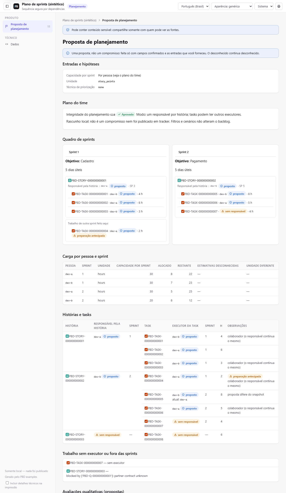
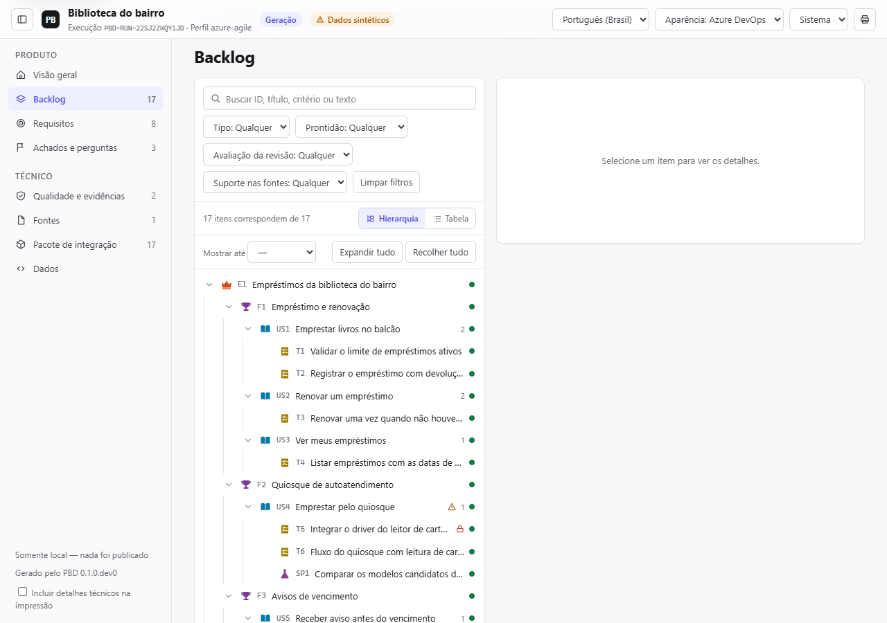
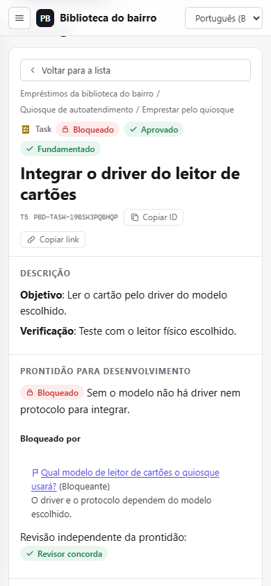
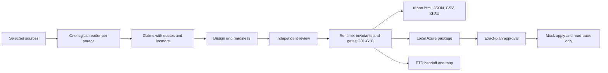

# Product Backlog Designer (PBD)

**From requirements to traceable, reviewable and actionable product backlogs.**

   

[Português (Brasil)](README.pt-BR.md) · [Documentation](docs/README.md) · [Example reports](examples/reports/README.md) · [Qualification ledger](benchmarks/qualification-ledger.json) · [Changelog](CHANGELOG.md)

> **Status — v0.9.0, initial release (0.x).** Usable for generating and reviewing backlogs locally; qualification is conditional, not complete. All 18 quality gates are implemented and every run reports what it could not prove. Live Azure DevOps or Jira access does not exist: tracker work is a local package plus an in-memory mock. Known limits are listed under [Quality and evidence](#quality-and-evidence).

## What it does

PBD is an agent skill plus a small deterministic Python runtime (`pbd`). You point your coding agent (Claude Code, or another host that can read a skill folder and run a command) at the requirement sources you choose and ask in plain language. The agent reads and reasons; the runtime checks.

- **Generate** Epics, Features, User Stories, acceptance criteria, Tasks and dependencies from one PRD or several sources (files, folders, archives, PDFs, images, DOCX, XLSX). An existing backlog, technical design or tracker account is optional.
- **Audit, compare, refine** an existing backlog against the sources, align two backlogs over the same independent inventory (no "winner"), and apply only the changes you approve.
- **Plan** a sprint proposal with your team's capacity, one accountable owner per story and task assignees, in each person's own unit; **evolve** the backlog when a PRD or ADR changes, keeping identities and human edits.
- **Hand off** to [Functional Test Designer](https://github.com/Soturine/functional-test-designer) for functional Test Cases, and map FTD's results back to PBD IDs.
- **Report**: one offline `report.html` (no server, no network) plus JSON, Markdown, CSV, XLSX and a local Azure DevOps package.

How it stays honest: one logical reader per declared source; claims trace to quotes and locators; a reviewer re-reads the sources before looking at the design; when the host cannot run a separate reviewer, the run says so (G13 BLOCKED). Deterministic validity (identity, graph, traceability, rendering, safety) is checked by code; semantic quality is judged by the agents and surfaced, never assumed. Confirmed by a source is not the same as ready to build: work that depends on an open blocking question is marked blocked and linked to it, and a reviewer dispute keeps the item out of a sprint until resolved.

**What PBD is not:** it does not execute tests, does not manage or write to a live tracker, and does not guarantee that every requirement is covered — it shows what was covered, handled as a question, blocked or not proven.

## Quick start

Requirements: Python 3.11+ and an agent host. The runtime needs only `jsonschema`; no hosted API is required (your agent uses its own model provider).

**Windows (PowerShell)**
```powershell
python -m venv $HOME\pbd-venv
& $HOME\pbd-venv\Scripts\Activate.ps1
python -m pip install https://github.com/Soturine/product-backlog-designer/releases/download/v0.9.0/product_backlog_designer-0.9.0-py3-none-any.whl
pbd --version
pbd doctor
pbd skill install --scope user          # or: --scope project --project C:\path\to\your\project
```

**macOS / Linux**
```sh
python3 -m venv ~/pbd-venv && . ~/pbd-venv/bin/activate
python -m pip install https://github.com/Soturine/product-backlog-designer/releases/download/v0.9.0/product_backlog_designer-0.9.0-py3-none-any.whl
pbd --version && pbd doctor
pbd skill install --scope user
```

From a clone instead: `git clone https://github.com/Soturine/product-backlog-designer.git`, then `python -m pip install ./product-backlog-designer`. Optional extras: `pdf` (PDF text layer, `pypdf`) and `browser` (Playwright, for the report's own tests). The skill folder holds instructions only; the agent calls the `pbd` you installed.

Then restart your agent session and ask, for example: *"Generate the complete backlog from docs/prd.md in Portuguese and prepare a local Azure DevOps package."* The agent prints where the report is: `<artifact root>/runs/<run id>/output/report.html`. Codex: `pbd skill install --target <project>/.agents/skills/product-backlog-designer` and name the skill in your request (explicit use is verified; automatic discovery is not). Details: [install](docs/install.md), [usage](docs/usage.md), [commands](docs/commands.md).

### Example requests
- *"Generate the backlog from these three sources: docs/prd.pdf (functional), adr/ (decisions), api.md (technical)."*
- *"Audit the backlog in export/backlog.csv against docs/prd.md"* · *"Compare backlog-a.json and backlog-b.json with the PRD"* · *"Add the missing limit criterion; apply only that change."*
- *"Plan two one-week sprints with two developers, one owner per story; our estimates are …"* · *"The PRD changed (docs/v2/prd.md); update the backlog without losing what exists."*

## Modes and outputs

| Mode | What you get |
|---|---|
| Generate | Epics → Features → Stories/Enablers/Spikes/Bugs → Tasks, acceptance criteria (list, table or Gherkin), dependencies, questions, readiness |
| Audit | Findings per source obligation, item and criterion; failing gates describe the audited backlog |
| Compare | Coverage of both sides over one independent inventory, many-to-many correspondences, differences; no winner or score |
| Refine / Evolve | Reviewable plan, digest-bound approval, no deletion; decisions supersede claims and answer questions; stale plans detected |
| Plan | Dependency-safe order; sprints only with known capacity; story owner vs task assignee, proposed vs actual vs derived; story points and hours never converted or added parent-to-child; unknown is never zero |
| Package | Local Azure DevOps package (Agile, Scrum, Basic, CMMI profiles) → exact-plan approval → **mock** apply and read-back (`MOCK_VERIFIED`); never a live write |
| Handoff | `ftd-handoff.json` + `ftd-instructions.md` for FTD; `pbd handoff ftd-map` links FTD Test Cases back to PBD IDs by exact ID only |

The report can be shown with a Generic, Azure DevOps or Jira **appearance** (original pictograms and colors only). Jira has no adapter, mapping or export in PBD; the appearance does not change the hierarchy or the target profile. The interface switches between Portuguese, English and Spanish offline; backlog content keeps its own language. [Reporting](docs/reporting.md) · [Azure (mock)](docs/azure.md) · [Planning](docs/planning-engineering.md) · [Work items](docs/work-items.md)

## See the report


| Development readiness and decisions | A blocked task and the question it waits for |
|---|---|
|  |  |
| **Every gate explained** | **Team sprint plan** |
|  |  |
| **Azure DevOps appearance** | **Mobile (390 px)** |
|  |  |

More captures (1440 to 320 px, light/dark, PT/EN/ES) are in [docs/images/report](docs/images/report/). Synthetic examples you can download and open: [generation](examples/reports/generate/report.html), [readiness](examples/reports/readiness/report.html), [audit](examples/reports/audit/report.html), [comparison](examples/reports/compare/report.html), [team plan](examples/reports/plan/plan-report.html) (GitHub shows HTML as source).

## Architecture



Agent-first (agents read and judge), native-first (originals are read with the host's own tools; extraction is a declared fallback), runtime-verified (every PASS is re-checked against artifact hashes). Local-first: no database, server, Docker or paid service. [Architecture](docs/architecture.md) · [Agent/runtime boundaries](docs/agent-runtime-boundaries.md) · [Security](docs/security.md)

## Quality and evidence

- **Gates.** G01–G18 are implemented. Each reports PASS, FAIL, BLOCKED, NOT_RUN or NOT_APPLICABLE with evidence; a benchmark threshold is a separate thing from a gate PASS, and a threshold pass never turns a FAIL into PASS. G18 (live round-trip) is always NOT_RUN: there is no live tracker. [Quality gates](docs/quality-gates.md)
- **v0.9.0 deterministic qualification** (main agent only, local, Windows 11, Python 3.11, system Edge): see [docs/evidence/v0.9.0.md](docs/evidence/v0.9.0.md) for the exact commit, test counts, branch coverage, the targeted mutation catalogue, Playwright and axe-core scans, packaging and a Linux run.
- **Semantic evidence comes from earlier commits** and is not re-claimed here: agent-led runs of generation (c08 ×3, a new holdout), comparison, refinement, planning, evolution, mock publication, native PDF reading, a second host (Codex) and a real FTD run that designed 48 Test Cases (designed, not executed; 8/8 FTD gates) — [corrective round](docs/evidence/corrective-round.md), [final qualification](docs/evidence/final-qualification.md). On one small case, a bare agent with no skill matched PBD on the gold at a third of the tokens; PBD's measured difference there was verifiability, not coverage. No superiority claim is made.
- **Accessibility.** An axe-core scan reports 0 violations on every report view (two themes, desktop and mobile); this is an automated scan, not a WCAG 2.2 AA conformance claim — manual screen-reader review was not done.
- **Open limits** ([ledger](benchmarks/qualification-ledger.json)): variance in how generators classify blocking questions (surfaced by the reviewer, QL-020); DOCX/XLSX originals cannot be opened natively by the Claude Code host (declared fallback, QL-017); automatic skill discovery on Codex unproven (QL-015); no screen-reader review (QL-011); FTD stores no PBD field natively — the link is the `ftd-map` sidecar (QL-021); two large functions are refactoring candidates (QL-022).

## License, attribution and safety

Licensed under the [Apache License 2.0](LICENSE) ([NOTICE](NOTICE)). Third-party material actually adapted (the Assertiva report status-tone pattern, Apache-2.0; Azure DevOps link reference names from microsoft/azure-devops-mcp, MIT) is listed with pinned sources in [third_party/](third_party/README.md) and [ATTRIBUTION.md](ATTRIBUTION.md). Microsoft, Azure DevOps, Atlassian and Jira are trademarks of their owners; PBD is not affiliated with them, and its icons are original drawings.

Public examples and benchmarks are synthetic. Never commit private sources or credentials. PBD never contacts a tracker; GitHub is only where this project is hosted. [Security](docs/security.md) · [Roadmap](docs/roadmap.md) · [Skill](SKILL.md)
