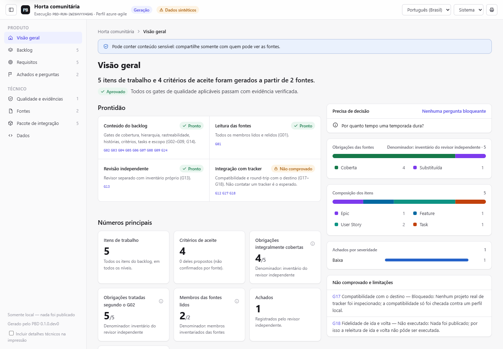
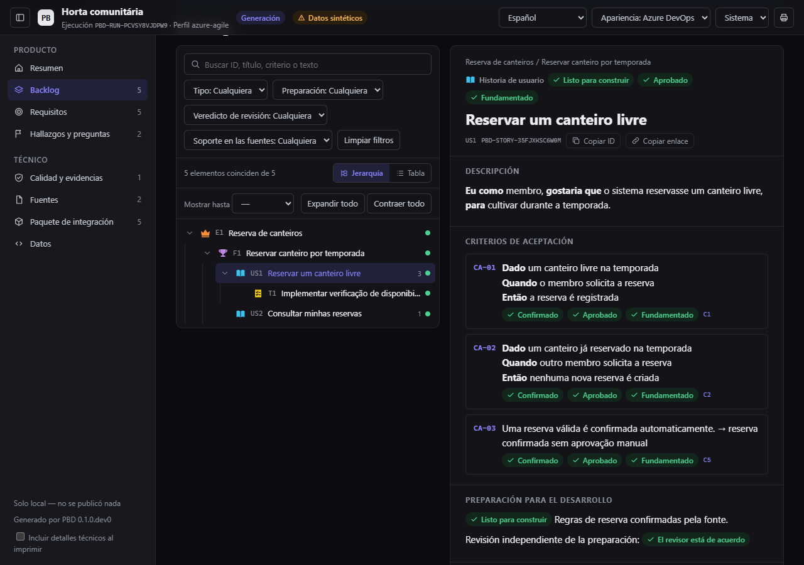
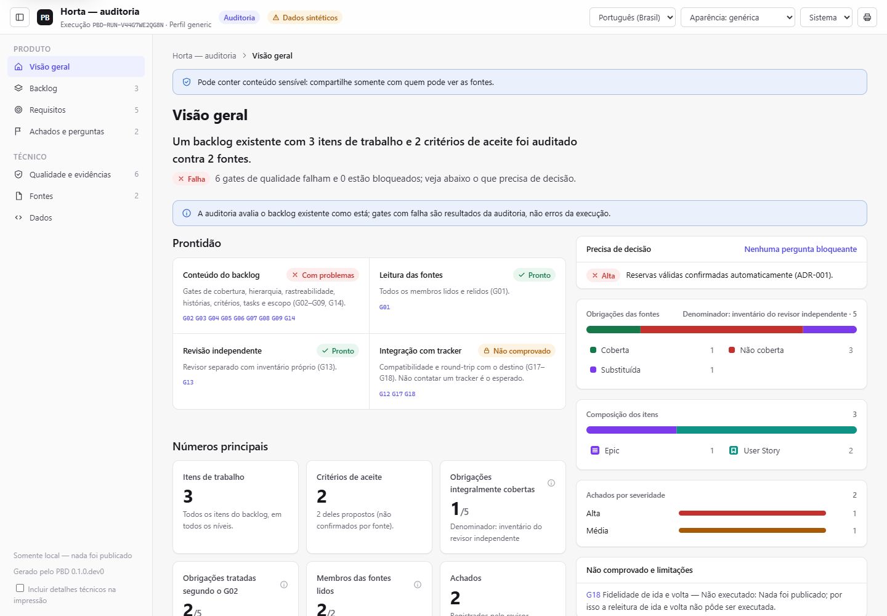
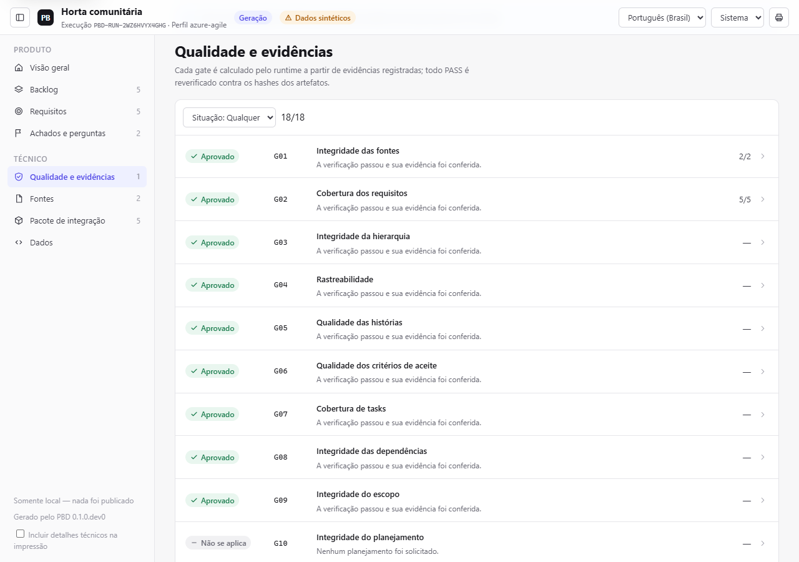
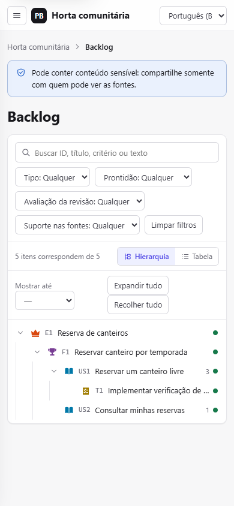
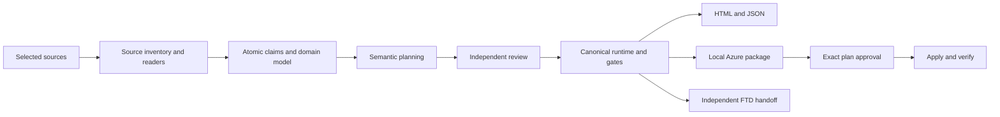

# Product Backlog Designer (PBD)

**From requirements to validated, traceable and actionable backlogs.**

[Português (Brasil)](README.pt-BR.md) · [Documentation](docs/README.md) · [Roadmap](docs/roadmap.md) · [Example reports](examples/reports/README.md) · [Research and code audit](docs/upstream-code-audit.md)

> **Development status:** pre-alpha. Agent-led generation from zero was dogfooded on 12 synthetic cases ([M1 evidence](docs/evidence/M1.md)). Audit, comparison, refinement, check, clarify and profile modes work on local files and are covered by deterministic tests; their agent-led semantic qualification is deferred to the final integrated qualification ([ledger](benchmarks/qualification-ledger.json)). Planning, incremental evolution, a mock-only Azure publication flow and the FTD handoff are implemented with deterministic tests; the final integrated qualification ([results](docs/evidence/final-qualification.md)) ran a new-session dogfood from one request, re-ran the affected M1 cases and an audit holdout; one correction re-run missed its threshold and is reported. Nothing contacts a tracker.

## Why PBD?

A requirements document is not yet a backlog. A backlog can look complete while missing a rule, exception, constraint or acceptance condition. PBD is designed to turn explicitly selected sources into a coherent plan, audit that plan independently, and publish approved work items without losing formatting, links or human decisions. It serves product owners, analysts, engineering teams, project managers and QA across domains.

One skill owns functional and technical backlog planning. [Functional Test Designer](https://github.com/Soturine/functional-test-designer) remains independent for functional Test Cases. The original requirements remain authoritative for both.

## The normal workflow

1. Put the sources in a private working directory and tell the agent what to read, or write a short [instructions.md](docs/instructions.md).
2. Ask the agent: **"Generate the complete backlog from these requirements and prepare a local Azure DevOps package."**
3. Open the HTML report, inspect the complete work-item tree, criteria, questions, findings and coverage. Resolve only material ambiguities.
4. If publication is desired, review the exact destination and proposed changes, then approve that plan. The runtime will apply and read back the results.

No need to invoke separate commands for source analysis, story writing, tasks, quality checks and rendering. They are internal stages. The preferred future agent entrypoint is `/pbd`; ordinary language is equally valid. Existing specialized entrypoints remain optional power-user controls. See [interaction contract](docs/usage.md).

### Minimal private instructions

```md
Read only docs/PRD.pdf and docs/TDD.pdf.
Generate Epics, Features, User Stories, acceptance criteria and Tasks.
Audit against the original requirements.
Language: Portuguese (Brazil).
Target: Azure DevOps Agile.
Output: HTML, JSON and local Azure import package.
Do not publish remotely.
```

Generation from scratch is the primary mode: an existing backlog is optional, never a prerequisite. Sources, language and scope can be supplied directly in chat instead. Technical sources and tracker credentials are optional for local generation. The skill must not invent their contents.

## Capabilities

| Mode | Result |
|---|---|
| Generate | Epics, Features, Stories, criteria, Tasks, dependencies and suggested priorities |
| Audit | Individual source/claim/item/criterion/task review, evidence, ambiguities, conflicts and unsupported additions |
| Compare | Independent backlogs aligned by semantic obligations, not title or item count |
| Refine | Targeted improvements, profile learning and change proposals |
| Plan | Estimates, risk, value, capacity and sprint suggestions when inputs support them |
| Evolve | PRD/ADR changes, impact, stable IDs, reconciliation and minimal updates |
| Publish | Azure discovery, snapshot, validated package, approval, apply, read-back and receipt |

Support Agile, Scrum, Basic, CMMI and custom process profiles; discover actual destination rules. GitHub and Jira are future adapters. Generate only selected levels when asked. Never fabricate dates, assignees, completed work or business values.

## What work items look like

**Epic:** objective, context, scope, exclusions and intended outcome.  
**Feature:** meaningful capability, value, related rules and child stories.  
**User Story:** **As a** library member, **I want** to reserve an available book, **so that** I can borrow it later.  
**Acceptance criteria:** an available title can be reserved; a title without available copies cannot be reserved.  
**Tasks:** implement reservation validation; implement persistence; verify both outcomes.

The example assumes the behavior is in the fictional source. Unknown reservation duration becomes a question, not a fabricated rule. Portuguese stories use **Eu como**, **gostaria que**, **para**; native HTML preserves bold and lists. Acceptance can be rendered as a native HTML table (ID, criterion, expected outcome), list or Gherkin. Alternative formats and enablers are supported when suitable. See [work items](docs/work-items.md), [story engineering](docs/story-engineering.md), [acceptance engineering](docs/acceptance-engineering.md).

## See the report

`report.html` is a single offline file (double click, no server, no network) that opens on an executive overview and drills down into a master/detail backlog explorer, requirements traceability, findings and questions, quality gates with evidence, sources, the local integration package and the canonical data. The interface switches between Portuguese, English and Spanish offline; backlog content stays in the language it was written in.


| Overview (pt-BR, light) | Backlog explorer with item detail (es, dark) |
|---|---|
|  |  |
| **Audit of an existing backlog** | **Comparison of two backlogs** |
|  |  |
| **Quality gates with evidence** | **Mobile (390 px)** |
|  |  |

More captures (1440/1280/768/390/320 px, light/dark, PT/EN/ES) are in [docs/images/report](docs/images/report/); the M1 renderer is kept for comparison in [docs/images/before-m2](docs/images/before-m2/). Open the synthetic examples yourself: [generation](examples/reports/generate/report.html), [audit](examples/reports/audit/report.html), [comparison](examples/reports/compare/report.html) (GitHub shows HTML as source: download or clone, then open in a browser). The 12 recorded M1 runs are re-rendered with the current renderer, clearly labelled, in [benchmarks/rerender/m1](benchmarks/rerender/m1/); the recorded originals in [benchmarks/runs/m1](benchmarks/runs/m1/) are unchanged.

## Output

```text
pbd-output/
  report.html                 # default human entry point, offline
  backlog.json                # canonical backlog and field provenance
  findings.json               # audit findings and evidence
  questions.json              # unresolved decisions
  traceability.json           # sources → claims → work items → criteria/tasks
  metrics.json                # honest counts, denominators and gates
  manifest.json               # versions, hashes, run status
  azure/
    azure-import.json         # local canonical package, not raw CLI input
    azure-import.csv          # optional portal-compatible subset
    publication-plan.json     # exact target-bound preview
    publication-result.json   # actual receipt, only after apply
```

Markdown, CSV, XLSX, dependency diagrams, comparison, sprint report and FTD handoff are optional or mode-dependent. A generated local package is not a published backlog. [Output specification](docs/reporting.md) · [Azure integration](docs/azure.md) · [Synthetic example JSON](examples/demo/backlog.json).

## Architecture



Agent-first: agents interpret actual source content. Deterministic Python owns identity, contracts, graphs, validation, persistence, rendering and transport. Local-first: no mandatory external database, server, paid API or Docker. Domain-agnostic, tracker-agnostic and privacy-first. [Architecture](docs/architecture.md) · [Reuse strategy](docs/upstream-code-audit.md).

## Assurance

Eighteen planned quality gates (original thirteen plus five extensions) distinguish structural validity from semantic coverage. Each claim gets a disposition; each work item and criterion is checked in reverse against evidence. INVEST, QUS-inspired review, Example Mapping, EARS and Gherkin are tools, not rigid templates or scores. No fixed number of items or acceptance criteria. Unknowns remain visible. Benchmark comparisons with HVE Core, BMAD, Spec Kit, Task Master and bare agents require independent gold, equal conditions where feasible, holdouts, mutations and honest metrics. [Gates](docs/quality-gates.md) · [Benchmarks](benchmarks/README.md).

## Integration and safety

Azure CLI authentication with REST/JSON Patch for lossless writes; optional CLI and portal CSV paths. Always read and discover fields first, match stable identity, preview changes, require exact-plan approval, verify remote revisions and read back. No automatic deletion, rule bypass or silent overwrite. [Azure](docs/azure.md) · [Security](docs/security.md).

## Roadmap and development

| Milestone | Scope | Status |
|---|---|---|
| M0 | foundation, schemas, runtime contracts, reuse decisions | runtime foundation done ([evidence](docs/evidence/M0.md)); profiles and gold fixtures moved to M1 |
| M1 | generation and default report/package workflow | substantially complete ([evidence](docs/evidence/M1.md)); open: new-session end-to-end run, Linux symlink tests |
| M2 | M1 fixes, audit, compare, refine, check, clarify, profile, report redesign with i18n | implemented; deterministic tests pass; semantic qualification deferred to the final qualification |
| M3 | Azure local snapshots and mock-only publication workflow | implemented (mock); live NOT_RUN |
| M4 | planning without invented capacity or dates | implemented; deterministic tests pass |
| M5 | source diffs, decisions, lineage, staleness | implemented; deterministic tests pass |
| M6 | FTD handoff, packaging, integrated flow, docs | implemented; final qualification run ([results](docs/evidence/final-qualification.md)) |

See [roadmap](docs/roadmap.md), [skill](SKILL.md), [changelog](CHANGELOG.md), [attribution](ATTRIBUTION.md). Public examples must be synthetic; never commit private sources or credentials. Repository license selection is pending; no third-party implementation has been vendored. Contributions and runtime installation instructions will be qualified before release.

## Implementation directive
[Agent-led execution](docs/agent-led-execution.md) · [Evidence and backlog health](docs/evidence-and-backlog-health.md) · [Calibration protocol](benchmarks/calibration.md) · [Master directive](docs/PBD_AGENT_LED_MASTER_DIRECTIVE.md). All implementation and qualification work is offline; live tracker access remains unqualified and requires separate authorization.
