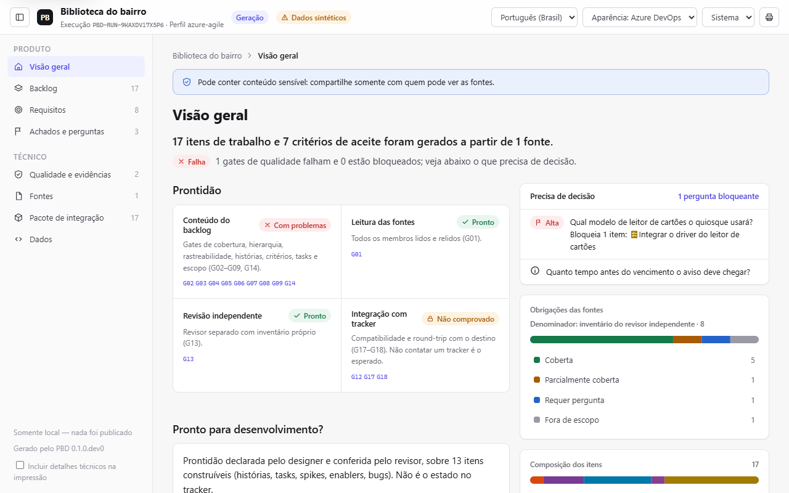
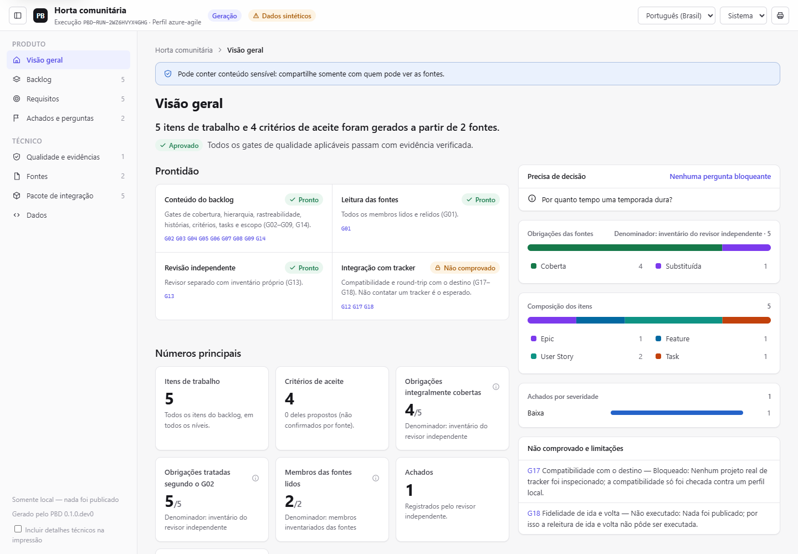
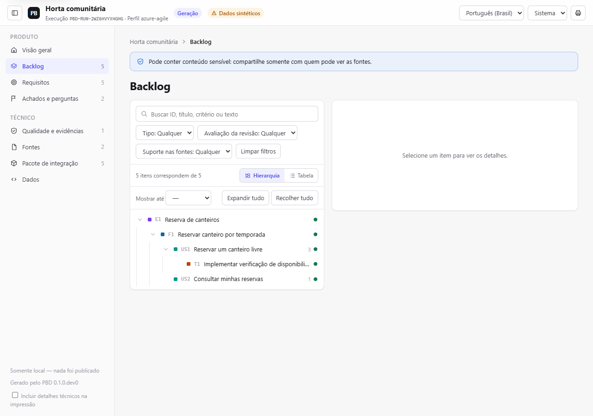
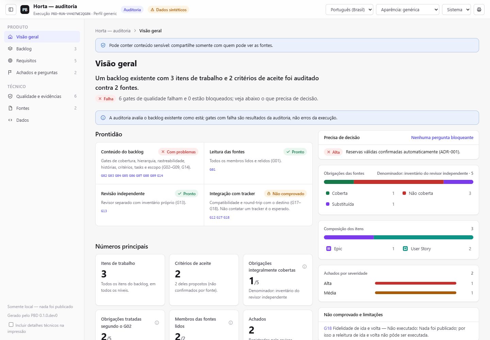
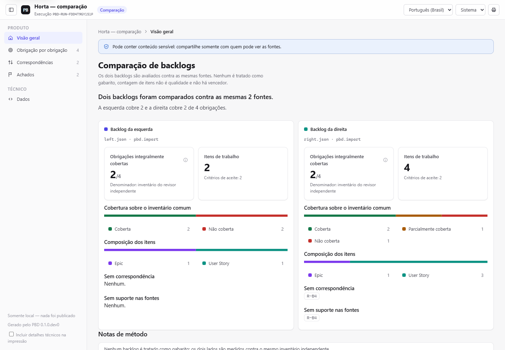

# Product Backlog Designer (PBD)

**De requisitos a um backlog validado, rastreável e pronto para revisão.**

[English](README.md) · [Documentação](docs/README.md) · [Roadmap](docs/roadmap.md) · [Relatórios de exemplo](examples/reports/README.md)

> **Estado atual:** pré-alpha. A geração agent-led a partir do zero foi exercitada em 12 casos sintéticos ([evidência M1](docs/evidence/M1.md)). Os modos de auditoria, comparação, refinamento, check, clarify e profile funcionam sobre arquivos locais e têm testes determinísticos; a qualificação semântica agent-led desses modos fica para a qualificação integrada final ([ledger](benchmarks/qualification-ledger.json)). Planejamento, evolução incremental, fluxo de publicação Azure somente com mock e handoff para a FTD estão implementados com testes determinísticos; a qualificação semântica e o dogfood em sessão nova ficam para a qualificação integrada final. Nada contata um tracker.

## Para que serve?

Uma única skill para interpretar PRDs, BRDs, TDDs, ADRs, atas, manuais, regras, código-fonte e backlogs existentes. A geração do zero é o modo principal; nenhum backlog existente, credencial ou TDD é obrigatório. Gera e audita a organização do trabalho, sem confundir planejamento com execução ou testes funcionais.

A [FTD](https://github.com/Soturine/functional-test-designer) continua independente: ela lê a autoridade funcional e elabora Test Cases. A PBD organiza o que precisa ser desenvolvido.

## Como será o uso

Forneça os arquivos diretamente ao agente ou use um [instructions.md](docs/instructions.md) simples:

```md
Leia somente docs/PRD.pdf e docs/TDD.pdf.
Gere épicos, features, user stories, critérios de aceite e tasks.
Audite a cobertura e prepare o pacote local para Azure DevOps Agile.
Idioma: português do Brasil.
Saídas: HTML e JSON.
Não publique nada.
```

Depois diga **"Use a Product Backlog Designer para gerar e validar meu backlog"**. A entrada proposta `/pbd` também poderá executar todo o fluxo. Não será necessário chamar separadamente 16 comandos. A skill interpreta a intenção, executa as etapas pertinentes e mostra as dúvidas e os resultados. A publicação remota sempre exige aprovação do plano exato. [Experiência de uso](docs/usage.md).

## O que a PBD deverá fazer

| Modo | Resultado |
|---|---|
| Gerar | Estrutura completa ou níveis selecionados |
| Auditar | Revisão individual de requisitos, itens, critérios e tasks |
| Comparar | Equivalências, lacunas e divergências entre backlogs |
| Refinar | Melhorias localizadas e perfis de escrita |
| Planejar | Prioridades, riscos, dependências, estimativas e sprints |
| Evoluir | Alterações incrementais de PRD/ADR e análise de impacto |
| Publicar | Exportar, preparar, aprovar, aplicar e verificar no Azure |

## Padrão de escrita

**Epic:** objetivo, contexto, dentro e fora do escopo e resultado esperado.  
**Feature:** capacidade do produto e valor esperado.  
**User Story:** **Eu como** membro da biblioteca, **gostaria que** o sistema permitisse reservar um livro disponível, **para** retirá-lo posteriormente.  
**Critérios de aceite:** lista, tabela nativa HTML (ID, condição, resultado esperado) ou Gherkin, em campo separado, com condições e resultados.  
**Tasks:** atividades acionáveis, resultado, verificação e dependências conforme a complexidade.

Negritos, listas, parágrafos, acentos e links são preservados nos campos nativos. Perfis Agile, Scrum, Basic, CMMI e personalizados respeitam a configuração real do destino. Campos não conhecidos permanecem em branco ou como propostas locais. [Padrões de Work Items](docs/work-items.md) · [Stories](docs/story-engineering.md) · [Aceite](docs/acceptance-engineering.md).

## Resultados

`report.html` é um único arquivo offline (duplo clique, sem servidor e sem rede). Abre numa visão geral executiva e aprofunda em um explorador de backlog mestre/detalhe, rastreabilidade de requisitos, achados e perguntas, gates de qualidade com evidências, fontes, o pacote de integração local e os dados canônicos. A interface alterna entre português, inglês e espanhol sem rede; o conteúdo do backlog permanece no idioma em que foi escrito.



| Visão geral | Explorador com detalhe do item |
|---|---|
|  |  |
| **Auditoria de backlog existente** | **Comparação de dois backlogs** |
|  |  |

Mais capturas (1440/1280/768/390/320 px, claro/escuro, PT/EN/ES) em [docs/images/report](docs/images/report/); o renderizador do M1 fica em [docs/images/before-m2](docs/images/before-m2/) para comparação. Exemplos sintéticos: [geração](examples/reports/generate/report.html), [auditoria](examples/reports/audit/report.html), [comparação](examples/reports/compare/report.html). As 12 execuções do M1 foram re-renderizadas, identificadas como re-render, em [benchmarks/rerender/m1](benchmarks/rerender/m1/); os originais em [benchmarks/runs/m1](benchmarks/runs/m1/) não mudaram.

`backlog.json` mantém a fonte canônica. O pacote `azure/azure-import.json` contém dados para o publicador, não um comando nativo do Azure CLI. CSV, Markdown, XLSX e integração FTD são opções. [Outputs](docs/reporting.md) · [Azure](docs/azure.md).

## Arquitetura e qualidade

Agentes leem as fontes autorizadas e fazem o raciocínio. Python valida contratos, grafos, identificadores, hashes, campos e publicação. Uma revisão independente confere o PRD original e cada item gerado. A PBD é local-first, sem servidor ou banco obrigatório, e não exige um provedor de IA próprio.

Os 18 gates planejados (13 originais e cinco extensões) preservam escopo, integridade, cobertura, qualidade de Stories/aceites/Tasks, dependências e publicação segura. INVEST, 3Cs, QUS, Example Mapping, EARS, Gherkin e outras técnicas são aplicadas de acordo com o contexto. Sem regras de negócio inventadas, falsa cobertura, metas artificiais de volume ou estimativas oficiais atribuídas à IA.

## Pesquisa e desenvolvimento

A base de engenharia considera componentes da FTD, Assertiva, Derivanta, HVE Core, Azure Prototype, Spec Kit, BMAD, OpenSpec, PM Skills e outros. [Auditoria de código](docs/upstream-code-audit.md) · [Pesquisa de mercado](docs/market-research.md). Reutilização depende de licença, testes e adaptação; não há código externo incorporado nesta fase.

M0 Fundação → M1 Geração → M2 Auditoria/comparação e relatório → M3 Azure (somente mock) → M4 Planejamento → M5 Evolução → M6 Integração. M0 e M1 concluídos com evidência ([M0](docs/evidence/M0.md), [M1](docs/evidence/M1.md)); M2–M6 implementados com testes determinísticos ([M2](docs/evidence/M2.md), [M3–M6](docs/evidence/M3-M6.md)); qualificação integrada final pendente. [Roadmap](docs/roadmap.md) · [Benchmarks](benchmarks/README.md) · [Segurança](docs/security.md).

## Implementação
[Contrato agent-led](docs/agent-led-execution.md) · [Evidências e saúde do backlog](docs/evidence-and-backlog-health.md) · [Calibração](benchmarks/calibration.md) · [Prompt mestre](docs/PBD_AGENT_LED_MASTER_DIRECTIVE.md). Desenvolvimento e benchmarks exclusivamente offline, com snapshots locais e mocks; nenhuma consulta ou alteração em tracker real nesta fase.
