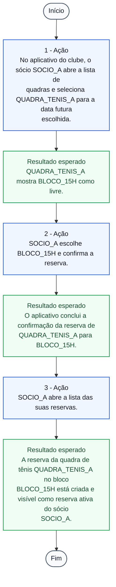

# TC-001 - Reservar uma quadra de tênis livre pelo aplicativo

**Status:** READY  
**Prioridade:** CRITICAL  
**Tipo:** FUNCTIONAL  
**Família de cenários:** Reserva de quadra

**Base do teste:** ACCEPTANCE  
**Tipo primário:** FUNCTIONAL  
**Adequação à automação:** HIGH  
**Prontidão para automação:** NEEDS_SELECTOR  
**Camada:** UI  
**Pendências:** MISSING_SELECTOR

## Objetivo
Confirmar que o sócio consegue reservar uma quadra de tênis pelo aplicativo do clube.

## Pré-condições
- SOCIO_A está cadastrado como sócio ativo e com sessão aberta no aplicativo do clube
- SOCIO_A não tem nenhuma reserva futura ativa
- QUADRA_TENIS_A está livre no bloco BLOCO_15H, dentro da janela de 7h às 22h, em uma data futura

## Dados de teste
- **SOCIO_A:** sócio ativo do clube, com sessão aberta no aplicativo e sem reservas futuras
- **QUADRA_TENIS_A:** quadra de tênis do clube, sem reservas no bloco BLOCO_15H
- **BLOCO_15H:** bloco de 1 hora, das 15h às 16h, de uma data futura

## Passos
| # | Ação | Resultado esperado | Esclarecimento |
|---:|---|---|:---:|
| 1 | No aplicativo do clube, o sócio SOCIO_A abre a lista de quadras e seleciona QUADRA_TENIS_A para a data futura escolhida. | QUADRA_TENIS_A mostra BLOCO_15H como livre. | Não |
| 2 | SOCIO_A escolhe BLOCO_15H e confirma a reserva. | O aplicativo conclui a confirmação da reserva de QUADRA_TENIS_A para BLOCO_15H. | Não |
| 3 | SOCIO_A abre a lista das suas reservas. | A reserva da quadra de tênis QUADRA_TENIS_A no bloco BLOCO_15H está criada e visível como reserva ativa do sócio SOCIO_A. | Não |

## Pós-condições
- SOCIO_A tem 1 reserva futura ativa em QUADRA_TENIS_A

## Limpeza
- Cancelar a reserva criada para devolver BLOCO_15H ao estado livre

## Restauração de estado
SELF_CLEANING — o próprio caso limpa (ver Limpeza)

## Rastreabilidade
- Requisitos: REQ-001
- Coverage points: CP-001
- Fontes: `sources/prd.md` (Objetivo (linha 4)), `sources/prd.md` (Objetivo (linha 4) e Requisitos, item 1 (linha 7))

## Artefato JSON
`test-cases/TC-001.json`

## Fluxo do Teste

