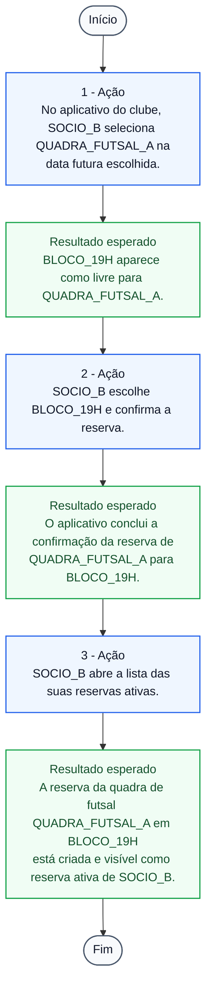

# TC-002 - Reservar uma quadra de futsal livre pelo aplicativo

**Status:** READY  
**Prioridade:** CRITICAL  
**Tipo:** FUNCTIONAL  
**Família de cenários:** Reserva de quadra

**Base do teste:** ACCEPTANCE  
**Tipo primário:** FUNCTIONAL  
**Adequação à automação:** HIGH  
**Prontidão para automação:** NEEDS_SELECTOR  
**Camada:** UI  
**Pendências:** MISSING_SELECTOR

## Objetivo
Confirmar que o sócio consegue reservar também uma quadra de futsal, segundo tipo de quadra do clube.

## Pré-condições
- SOCIO_B está cadastrado como sócio ativo e com sessão aberta no aplicativo do clube
- SOCIO_B não tem reservas futuras
- QUADRA_FUTSAL_A está livre no bloco BLOCO_19H, dentro da janela de reservas, em uma data futura

## Dados de teste
- **SOCIO_B:** sócio ativo do clube com sessão aberta e sem reservas futuras
- **QUADRA_FUTSAL_A:** quadra de futsal do clube, sem reservas no bloco BLOCO_19H
- **BLOCO_19H:** bloco das 19h às 20h de uma data futura

## Passos
| # | Ação | Resultado esperado | Esclarecimento |
|---:|---|---|:---:|
| 1 | No aplicativo do clube, SOCIO_B seleciona QUADRA_FUTSAL_A na data futura escolhida. | BLOCO_19H aparece como livre para QUADRA_FUTSAL_A. | Não |
| 2 | SOCIO_B escolhe BLOCO_19H e confirma a reserva. | O aplicativo conclui a confirmação da reserva de QUADRA_FUTSAL_A para BLOCO_19H. | Não |
| 3 | SOCIO_B abre a lista das suas reservas ativas. | A reserva da quadra de futsal QUADRA_FUTSAL_A em BLOCO_19H está criada e visível como reserva ativa de SOCIO_B. | Não |

## Pós-condições
- SOCIO_B tem 1 reserva futura ativa em QUADRA_FUTSAL_A

## Limpeza
- Cancelar a reserva criada

## Restauração de estado
SELF_CLEANING — o próprio caso limpa (ver Limpeza)

## Rastreabilidade
- Requisitos: REQ-001
- Coverage points: CP-002
- Fontes: `sources/prd.md` (Objetivo (linha 4)), `sources/prd.md` (Objetivo (linha 4) e Requisitos, item 1 (linha 7))

## Artefato JSON
`test-cases/TC-002.json`

## Fluxo do Teste

