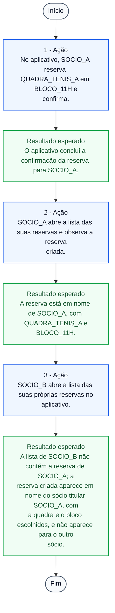

# TC-003 - Reserva criada em nome do sócio que reservou

**Status:** READY  
**Prioridade:** HIGH  
**Tipo:** DATA_INTEGRITY  
**Família de cenários:** Reserva de quadra

**Base do teste:** ACCEPTANCE  
**Tipo primário:** DATA_INTEGRITY  
**Adequação à automação:** HIGH  
**Prontidão para automação:** NEEDS_SELECTOR  
**Camada:** UI  
**Pendências:** MISSING_SELECTOR

## Objetivo
Verificar que o titular da reserva criada é o sócio que a solicitou, e não outro.

## Pré-condições
- SOCIO_A e SOCIO_B são sócios ativos; SOCIO_A tem sessão aberta no aplicativo
- QUADRA_TENIS_A está livre no bloco BLOCO_11H de uma data futura
- Nenhum dos dois sócios tem reservas futuras

## Dados de teste
- **SOCIO_A:** sócio titular que fará a reserva, sem reservas futuras
- **SOCIO_B:** outro sócio ativo, sem reservas futuras, usado para conferir que não recebe a reserva
- **QUADRA_TENIS_A:** quadra de tênis livre em BLOCO_11H
- **BLOCO_11H:** bloco das 11h às 12h de uma data futura

## Passos
| # | Ação | Resultado esperado | Esclarecimento |
|---:|---|---|:---:|
| 1 | No aplicativo, SOCIO_A reserva QUADRA_TENIS_A em BLOCO_11H e confirma. | O aplicativo conclui a confirmação da reserva para SOCIO_A. | Não |
| 2 | SOCIO_A abre a lista das suas reservas e observa a reserva criada. | A reserva está em nome de SOCIO_A, com QUADRA_TENIS_A e BLOCO_11H. | Não |
| 3 | SOCIO_B abre a lista das suas próprias reservas no aplicativo. | A lista de SOCIO_B não contém a reserva de SOCIO_A; a reserva criada aparece em nome do sócio titular SOCIO_A, com a quadra e o bloco escolhidos, e não aparece para o outro sócio. | Não |

## Pós-condições
- Existe uma reserva ativa em nome de SOCIO_A

## Limpeza
- Cancelar a reserva de SOCIO_A

## Restauração de estado
SELF_CLEANING — o próprio caso limpa (ver Limpeza)

## Rastreabilidade
- Requisitos: REQ-002
- Coverage points: CP-003
- Fontes: `sources/prd.md` (Requisitos, item 1 (linha 7))

## Artefato JSON
`test-cases/TC-003.json`

## Fluxo do Teste

