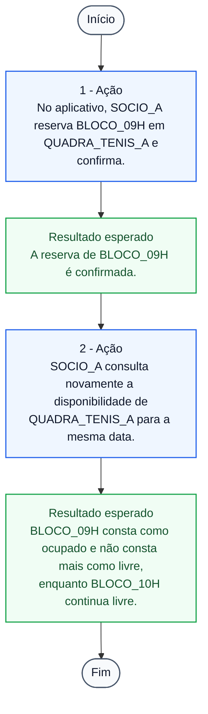

# TC-004 - Bloco reservado deixa de aparecer como livre

**Status:** READY  
**Prioridade:** HIGH  
**Tipo:** STATE_TRANSITION  
**Família de cenários:** Reserva de quadra

**Base do teste:** ACCEPTANCE  
**Tipo primário:** STATE_TRANSITION  
**Adequação à automação:** HIGH  
**Prontidão para automação:** NEEDS_SELECTOR  
**Camada:** UI  
**Pendências:** MISSING_SELECTOR

## Objetivo
Garantir que o aplicativo atualiza a disponibilidade da quadra após a reserva.

## Pré-condições
- SOCIO_A é sócio ativo com sessão aberta
- QUADRA_TENIS_A tem livres os blocos BLOCO_09H e BLOCO_10H de uma data futura

## Dados de teste
- **SOCIO_A:** sócio ativo sem reservas futuras
- **QUADRA_TENIS_A:** quadra de tênis com os blocos BLOCO_09H e BLOCO_10H livres
- **BLOCO_09H:** bloco das 9h às 10h, que será reservado
- **BLOCO_10H:** bloco das 10h às 11h, que permanece livre

## Passos
| # | Ação | Resultado esperado | Esclarecimento |
|---:|---|---|:---:|
| 1 | No aplicativo, SOCIO_A reserva BLOCO_09H em QUADRA_TENIS_A e confirma. | A reserva de BLOCO_09H é confirmada. | Não |
| 2 | SOCIO_A consulta novamente a disponibilidade de QUADRA_TENIS_A para a mesma data. | BLOCO_09H consta como ocupado e não consta mais como livre, enquanto BLOCO_10H continua livre. | Não |

## Pós-condições
- BLOCO_09H ocupado e BLOCO_10H livre

## Limpeza
- Cancelar a reserva de BLOCO_09H

## Restauração de estado
SELF_CLEANING — o próprio caso limpa (ver Limpeza)

## Rastreabilidade
- Requisitos: REQ-002
- Coverage points: CP-004
- Fontes: `sources/prd.md` (Requisitos, item 1 (linha 7))

## Artefato JSON
`test-cases/TC-004.json`

## Fluxo do Teste

