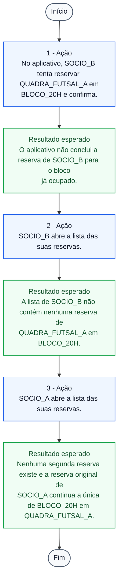

# TC-005 - Recusar reserva de bloco já reservado na quadra

**Status:** NEEDS_REVIEW  
**Prioridade:** CRITICAL  
**Tipo:** NEGATIVE  
**Família de cenários:** Reserva de quadra

**Base do teste:** ACCEPTANCE  
**Tipo primário:** NEGATIVE  
**Adequação à automação:** HIGH  
**Prontidão para automação:** NEEDS_POLICY  
**Camada:** UI  
**Pendências:** AMBIGUOUS_POLICY, MISSING_SELECTOR  
**Perguntas:** Q-004

## Objetivo
Impedir que dois sócios fiquem com a mesma quadra no mesmo bloco.

## Pré-condições
- SOCIO_A e SOCIO_B são sócios ativos sem reservas futuras
- SOCIO_A já reservou QUADRA_FUTSAL_A em BLOCO_20H de uma data futura
- SOCIO_B tem sessão aberta no aplicativo

## Dados de teste
- **SOCIO_A:** titular da reserva original
- **SOCIO_B:** segundo sócio, sem reservas futuras, que tentará reservar o mesmo bloco
- **QUADRA_FUTSAL_A:** quadra de futsal já reservada em BLOCO_20H
- **BLOCO_20H:** bloco das 20h às 21h de uma data futura

## Passos
| # | Ação | Resultado esperado | Esclarecimento |
|---:|---|---|:---:|
| 1 | No aplicativo, SOCIO_B tenta reservar QUADRA_FUTSAL_A em BLOCO_20H e confirma. | O aplicativo não conclui a reserva de SOCIO_B para o bloco já ocupado. | Não |
| 2 | SOCIO_B abre a lista das suas reservas. | A lista de SOCIO_B não contém nenhuma reserva de QUADRA_FUTSAL_A em BLOCO_20H. | Não |
| 3 | SOCIO_A abre a lista das suas reservas. | Nenhuma segunda reserva existe e a reserva original de SOCIO_A continua a única de BLOCO_20H em QUADRA_FUTSAL_A. | Não |

## Pós-condições
- BLOCO_20H segue ocupado apenas pela reserva de SOCIO_A

## Limpeza
- Cancelar a reserva de SOCIO_A

## Restauração de estado
SELF_CLEANING — o próprio caso limpa (ver Limpeza)

## Rastreabilidade
- Requisitos: REQ-002
- Coverage points: CP-005
- Fontes: `sources/prd.md` (Requisitos, item 1 (linha 7)), `sources/prd.md` (Requisitos, item 1 (linha 7): reserva de quadra livre)

## Artefato JSON
`test-cases/TC-005.json`

## Fluxo do Teste

