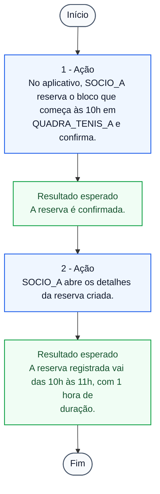

# TC-006 - Reserva ocupa exatamente 1 hora

**Status:** READY  
**Prioridade:** HIGH  
**Tipo:** BOUNDARY  
**Família de cenários:** Reserva de quadra

**Base do teste:** ACCEPTANCE  
**Tipo primário:** BOUNDARY  
**Adequação à automação:** HIGH  
**Prontidão para automação:** NEEDS_SELECTOR  
**Camada:** UI  
**Pendências:** MISSING_SELECTOR

## Objetivo
Confirmar que o bloco reservado tem a duração fixa de 1 hora.

## Pré-condições
- SOCIO_A é sócio ativo com sessão aberta e sem reservas futuras
- QUADRA_TENIS_A está livre a partir das 10h em uma data futura

## Dados de teste
- **SOCIO_A:** sócio ativo sem reservas futuras
- **QUADRA_TENIS_A:** quadra de tênis livre no bloco que começa às 10h

## Passos
| # | Ação | Resultado esperado | Esclarecimento |
|---:|---|---|:---:|
| 1 | No aplicativo, SOCIO_A reserva o bloco que começa às 10h em QUADRA_TENIS_A e confirma. | A reserva é confirmada. | Não |
| 2 | SOCIO_A abre os detalhes da reserva criada. | A reserva registrada vai das 10h às 11h, com 1 hora de duração. | Não |

## Pós-condições
- Reserva ativa das 10h às 11h

## Limpeza
- Cancelar a reserva

## Restauração de estado
SELF_CLEANING — o próprio caso limpa (ver Limpeza)

## Rastreabilidade
- Requisitos: REQ-002
- Coverage points: CP-006
- Fontes: `sources/prd.md` (Requisitos, item 1 (linha 7)), `sources/prd.md` (Requisitos, item 1 (linha 7): blocos de 1 hora)

## Artefato JSON
`test-cases/TC-006.json`

## Fluxo do Teste

