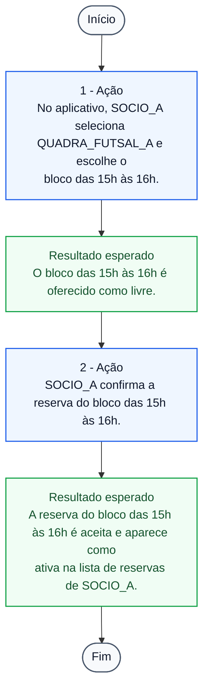

# TC-007 - Aceitar bloco dentro da janela de 7h a 22h

**Status:** READY  
**Prioridade:** HIGH  
**Tipo:** FUNCTIONAL  
**Família de cenários:** Janela de horário

**Base do teste:** ACCEPTANCE  
**Tipo primário:** FUNCTIONAL  
**Adequação à automação:** HIGH  
**Prontidão para automação:** NEEDS_SELECTOR  
**Camada:** UI  
**Pendências:** MISSING_SELECTOR

## Objetivo
Verificar que um bloco típico no meio da janela de funcionamento é aceito.

## Pré-condições
- SOCIO_A é sócio ativo com sessão aberta e sem reservas futuras
- QUADRA_FUTSAL_A está livre das 15h às 16h em uma data futura

## Dados de teste
- **SOCIO_A:** sócio ativo sem reservas futuras
- **QUADRA_FUTSAL_A:** quadra de futsal livre das 15h às 16h

## Passos
| # | Ação | Resultado esperado | Esclarecimento |
|---:|---|---|:---:|
| 1 | No aplicativo, SOCIO_A seleciona QUADRA_FUTSAL_A e escolhe o bloco das 15h às 16h. | O bloco das 15h às 16h é oferecido como livre. | Não |
| 2 | SOCIO_A confirma a reserva do bloco das 15h às 16h. | A reserva do bloco das 15h às 16h é aceita e aparece como ativa na lista de reservas de SOCIO_A. | Não |

## Pós-condições
- Reserva ativa das 15h às 16h

## Limpeza
- Cancelar a reserva

## Restauração de estado
SELF_CLEANING — o próprio caso limpa (ver Limpeza)

## Rastreabilidade
- Requisitos: REQ-002
- Coverage points: CP-007
- Fontes: `sources/prd.md` (Requisitos, item 1 (linha 7)), `sources/prd.md` (Requisitos, item 1 (linha 7): entre 7h e 22h)

## Artefato JSON
`test-cases/TC-007.json`

## Fluxo do Teste

