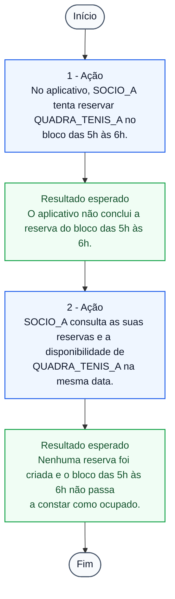

# TC-008 - Recusar bloco fora da janela de 7h a 22h

**Status:** NEEDS_REVIEW  
**Prioridade:** HIGH  
**Tipo:** NEGATIVE  
**Família de cenários:** Janela de horário

**Base do teste:** ACCEPTANCE  
**Tipo primário:** NEGATIVE  
**Adequação à automação:** HIGH  
**Prontidão para automação:** NEEDS_POLICY  
**Camada:** UI  
**Pendências:** AMBIGUOUS_POLICY, MISSING_SELECTOR  
**Perguntas:** Q-004

## Objetivo
Verificar que o aplicativo não aceita reserva de bloco claramente fora do horário permitido.

## Pré-condições
- SOCIO_A é sócio ativo com sessão aberta e sem reservas futuras
- QUADRA_TENIS_A não tem reservas às 5h de uma data futura

## Dados de teste
- **SOCIO_A:** sócio ativo sem reservas futuras
- **QUADRA_TENIS_A:** quadra de tênis sem reservas no período das 5h às 6h

## Passos
| # | Ação | Resultado esperado | Esclarecimento |
|---:|---|---|:---:|
| 1 | No aplicativo, SOCIO_A tenta reservar QUADRA_TENIS_A no bloco das 5h às 6h. | O aplicativo não conclui a reserva do bloco das 5h às 6h. | Não |
| 2 | SOCIO_A consulta as suas reservas e a disponibilidade de QUADRA_TENIS_A na mesma data. | Nenhuma reserva foi criada e o bloco das 5h às 6h não passa a constar como ocupado. | Não |

## Pós-condições
- SOCIO_A segue sem reservas futuras

## Limpeza
- Nenhum

## Restauração de estado
REQUIRES_FIXTURE_RESET — o harness deve reiniciar as fixtures de Dados de teste antes do próximo caso

## Rastreabilidade
- Requisitos: REQ-002
- Coverage points: CP-008
- Fontes: `sources/prd.md` (Requisitos, item 1 (linha 7)), `sources/prd.md` (Requisitos, item 1 (linha 7): entre 7h e 22h)

## Artefato JSON
`test-cases/TC-008.json`

## Fluxo do Teste

