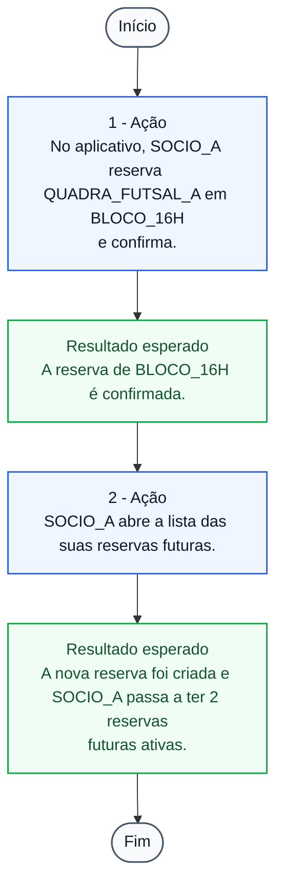

# TC-009 - Criar reserva quando o sócio tem menos de 2 futuras

**Status:** READY  
**Prioridade:** HIGH  
**Tipo:** BOUNDARY  
**Família de cenários:** Limite de reservas futuras

**Base do teste:** ACCEPTANCE  
**Tipo primário:** BOUNDARY  
**Adequação à automação:** HIGH  
**Prontidão para automação:** NEEDS_SELECTOR  
**Camada:** UI  
**Pendências:** MISSING_SELECTOR

## Objetivo
Verificar que o limite de 2 reservas futuras não impede quem ainda está abaixo dele.

## Pré-condições
- SOCIO_A é sócio ativo com sessão aberta
- SOCIO_A tem exatamente 1 reserva futura ativa, em QUADRA_TENIS_A às 9h
- QUADRA_FUTSAL_A está livre no bloco BLOCO_16H de uma data futura

## Dados de teste
- **SOCIO_A:** sócio ativo com 1 reserva futura ativa
- **QUADRA_TENIS_A:** quadra de tênis onde SOCIO_A já tem a reserva das 9h
- **QUADRA_FUTSAL_A:** quadra de futsal livre em BLOCO_16H
- **BLOCO_16H:** bloco das 16h às 17h de uma data futura

## Passos
| # | Ação | Resultado esperado | Esclarecimento |
|---:|---|---|:---:|
| 1 | No aplicativo, SOCIO_A reserva QUADRA_FUTSAL_A em BLOCO_16H e confirma. | A reserva de BLOCO_16H é confirmada. | Não |
| 2 | SOCIO_A abre a lista das suas reservas futuras. | A nova reserva foi criada e SOCIO_A passa a ter 2 reservas futuras ativas. | Não |

## Pós-condições
- SOCIO_A com 2 reservas futuras ativas

## Limpeza
- Cancelar as duas reservas de SOCIO_A

## Restauração de estado
SELF_CLEANING — o próprio caso limpa (ver Limpeza)

## Rastreabilidade
- Requisitos: REQ-003
- Coverage points: CP-010
- Fontes: `sources/prd.md` (Requisitos, item 2 (linha 8))

## Artefato JSON
`test-cases/TC-009.json`

## Fluxo do Teste

