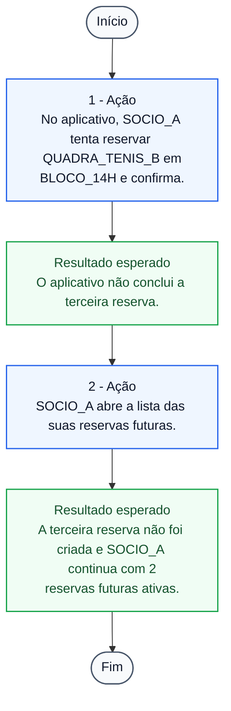

# TC-010 - Recusar terceira reserva futura do sócio

**Status:** NEEDS_REVIEW  
**Prioridade:** CRITICAL  
**Tipo:** BOUNDARY  
**Família de cenários:** Limite de reservas futuras

**Base do teste:** ACCEPTANCE  
**Tipo primário:** BOUNDARY  
**Adequação à automação:** HIGH  
**Prontidão para automação:** NEEDS_POLICY  
**Camada:** UI  
**Pendências:** AMBIGUOUS_POLICY, MISSING_SELECTOR  
**Perguntas:** Q-004

## Objetivo
Garantir que o teto de 2 reservas futuras é respeitado.

## Pré-condições
- SOCIO_A é sócio ativo com sessão aberta
- SOCIO_A tem exatamente 2 reservas futuras ativas, uma em QUADRA_TENIS_A e outra em QUADRA_FUTSAL_A
- QUADRA_TENIS_B está livre no bloco BLOCO_14H de uma data futura

## Dados de teste
- **SOCIO_A:** sócio ativo com 2 reservas futuras ativas
- **QUADRA_TENIS_A:** quadra de tênis da primeira reserva
- **QUADRA_FUTSAL_A:** quadra de futsal da segunda reserva
- **QUADRA_TENIS_B:** terceira quadra, livre em BLOCO_14H
- **BLOCO_14H:** bloco das 14h às 15h de uma data futura

## Passos
| # | Ação | Resultado esperado | Esclarecimento |
|---:|---|---|:---:|
| 1 | No aplicativo, SOCIO_A tenta reservar QUADRA_TENIS_B em BLOCO_14H e confirma. | O aplicativo não conclui a terceira reserva. | Não |
| 2 | SOCIO_A abre a lista das suas reservas futuras. | A terceira reserva não foi criada e SOCIO_A continua com 2 reservas futuras ativas. | Não |

## Pós-condições
- SOCIO_A com 2 reservas futuras

## Limpeza
- Cancelar as 2 reservas de SOCIO_A

## Restauração de estado
SELF_CLEANING — o próprio caso limpa (ver Limpeza)

## Rastreabilidade
- Requisitos: REQ-003
- Coverage points: CP-011
- Fontes: `sources/prd.md` (Requisitos, item 2 (linha 8))

## Artefato JSON
`test-cases/TC-010.json`

## Fluxo do Teste

