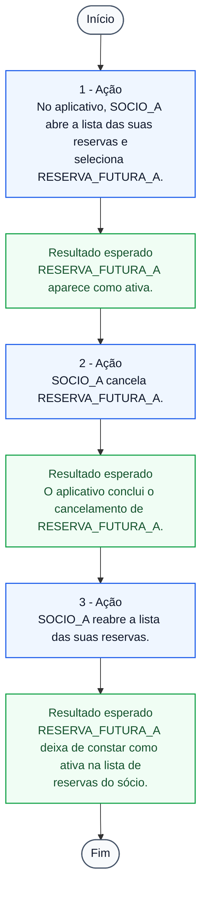

# TC-011 - Sócio cancela a própria reserva futura

**Status:** NEEDS_REVIEW  
**Prioridade:** HIGH  
**Tipo:** STATE_TRANSITION  
**Família de cenários:** Cancelamento

**Base do teste:** ACCEPTANCE  
**Tipo primário:** STATE_TRANSITION  
**Adequação à automação:** HIGH  
**Prontidão para automação:** NEEDS_POLICY  
**Camada:** UI  
**Pendências:** AMBIGUOUS_POLICY, MISSING_SELECTOR, BLOCKING_QUESTION  
**Perguntas:** Q-001

## Objetivo
Confirmar que o sócio consegue cancelar uma reserva sua e que ela deixa de estar ativa.

## Pré-condições
- SOCIO_A é sócio ativo com sessão aberta
- SOCIO_A tem uma reserva futura ativa em QUADRA_TENIS_A, marcada para daqui a vários dias, com antecedência confortavelmente grande

## Dados de teste
- **SOCIO_A:** sócio titular da reserva
- **QUADRA_TENIS_A:** quadra de tênis da reserva a cancelar
- **RESERVA_FUTURA_A:** reserva ativa de SOCIO_A em QUADRA_TENIS_A, marcada com antecedência grande

## Passos
| # | Ação | Resultado esperado | Esclarecimento |
|---:|---|---|:---:|
| 1 | No aplicativo, SOCIO_A abre a lista das suas reservas e seleciona RESERVA_FUTURA_A. | RESERVA_FUTURA_A aparece como ativa. | Não |
| 2 | SOCIO_A cancela RESERVA_FUTURA_A. | O aplicativo conclui o cancelamento de RESERVA_FUTURA_A. | Não |
| 3 | SOCIO_A reabre a lista das suas reservas. | RESERVA_FUTURA_A deixa de constar como ativa na lista de reservas do sócio. | Não |

## Pós-condições
- SOCIO_A sem reservas futuras ativas

## Limpeza
- Nenhum

## Restauração de estado
REQUIRES_FIXTURE_RESET — o harness deve reiniciar as fixtures de Dados de teste antes do próximo caso

## Rastreabilidade
- Requisitos: REQ-004
- Coverage points: CP-012
- Fontes: `sources/prd.md` (Requisitos, item 3 (linha 9))

## Artefato JSON
`test-cases/TC-011.json`

## Fluxo do Teste

