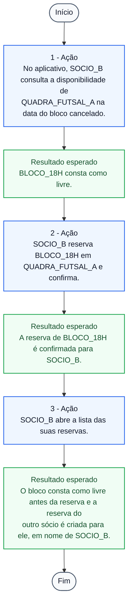

# TC-012 - Bloco cancelado volta a ficar disponível

**Status:** READY  
**Prioridade:** HIGH  
**Tipo:** STATE_TRANSITION  
**Família de cenários:** Cancelamento

**Base do teste:** ACCEPTANCE  
**Tipo primário:** STATE_TRANSITION  
**Adequação à automação:** HIGH  
**Prontidão para automação:** NEEDS_SELECTOR  
**Camada:** UI  
**Pendências:** MISSING_SELECTOR

## Objetivo
Verificar que o cancelamento devolve o bloco ao conjunto de horários livres da quadra.

## Pré-condições
- SOCIO_A cancelou a sua reserva de QUADRA_FUTSAL_A em BLOCO_18H de uma data futura, com grande antecedência
- SOCIO_B é sócio ativo com sessão aberta e sem reservas futuras

## Dados de teste
- **SOCIO_A:** sócio que cancelou a reserva
- **SOCIO_B:** outro sócio ativo sem reservas futuras
- **QUADRA_FUTSAL_A:** quadra de futsal cujo bloco foi liberado
- **BLOCO_18H:** bloco das 18h às 19h de uma data futura

## Passos
| # | Ação | Resultado esperado | Esclarecimento |
|---:|---|---|:---:|
| 1 | No aplicativo, SOCIO_B consulta a disponibilidade de QUADRA_FUTSAL_A na data do bloco cancelado. | BLOCO_18H consta como livre. | Não |
| 2 | SOCIO_B reserva BLOCO_18H em QUADRA_FUTSAL_A e confirma. | A reserva de BLOCO_18H é confirmada para SOCIO_B. | Não |
| 3 | SOCIO_B abre a lista das suas reservas. | O bloco consta como livre antes da reserva e a reserva do outro sócio é criada para ele, em nome de SOCIO_B. | Não |

## Pós-condições
- BLOCO_18H reservado por SOCIO_B

## Limpeza
- Cancelar a reserva de SOCIO_B

## Restauração de estado
SELF_CLEANING — o próprio caso limpa (ver Limpeza)

## Rastreabilidade
- Requisitos: REQ-004
- Coverage points: CP-013
- Fontes: `sources/prd.md` (Requisitos, item 3 (linha 9)), `sources/prd.md` (Requisitos, item 3 (linha 9) e item 1 (linha 7))

## Artefato JSON
`test-cases/TC-012.json`

## Fluxo do Teste

