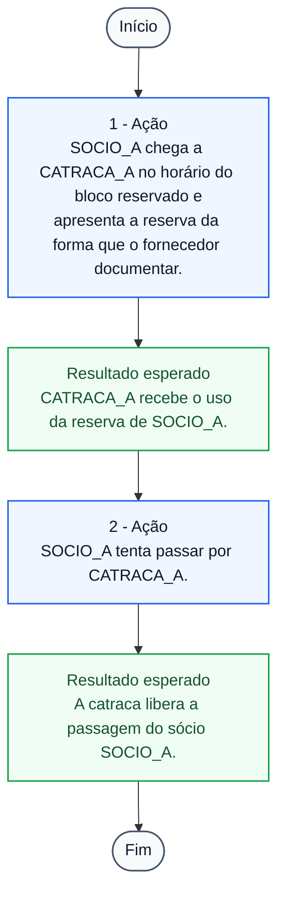

# TC-013 - Catraca libera o sócio que usa a reserva do horário

**Status:** BLOCKED_EXTERNAL_DEPENDENCY  
**Prioridade:** CRITICAL  
**Tipo:** HARDWARE_INTEGRATION  
**Família de cenários:** Acesso pela catraca

**Base do teste:** ACCEPTANCE  
**Tipo primário:** HARDWARE_INTEGRATION  
**Adequação à automação:** MANUAL_ONLY  
**Prontidão para automação:** NOT_APPLICABLE  
**Camada:** HARDWARE  
**Pendências:** EXTERNAL_DEPENDENCY_UNAVAILABLE, MISSING_EXECUTION_SURFACE, BLOCKING_QUESTION  
**Perguntas:** Q-002

## Objetivo
Verificar a entrada do sócio pela catraca usando a reserva válida para o horário atual.

## Pré-condições
- SOCIO_A é sócio ativo e tem reserva ativa de QUADRA_TENIS_A para o bloco em andamento
- A catraca de acesso às quadras está em operação e integrada ao aplicativo
- O contrato da API do fornecedor de catracas não foi entregue, então a forma de usar a reserva na catraca é desconhecida

## Dados de teste
- **SOCIO_A:** sócio titular da reserva do horário atual
- **QUADRA_TENIS_A:** quadra de tênis com reserva em andamento
- **CATRACA_A:** catraca que dá acesso às quadras, integrada ao sistema do fornecedor

## Passos
| # | Ação | Resultado esperado | Esclarecimento |
|---:|---|---|:---:|
| 1 | SOCIO_A chega a CATRACA_A no horário do bloco reservado e apresenta a reserva da forma que o fornecedor documentar. | CATRACA_A recebe o uso da reserva de SOCIO_A. | Não |
| 2 | SOCIO_A tenta passar por CATRACA_A. | A catraca libera a passagem do sócio SOCIO_A. | Não |

## Pós-condições
- SOCIO_A dentro da área das quadras

## Limpeza
- Restabelecer CATRACA_A ao estado de espera

## Restauração de estado
SELF_CLEANING — o próprio caso limpa (ver Limpeza)

## Rastreabilidade
- Requisitos: REQ-005
- Coverage points: CP-015
- Fontes: `sources/prd.md` (Requisitos, item 4 (linha 10))

## Artefato JSON
`test-cases/TC-013.json`

## Fluxo do Teste

