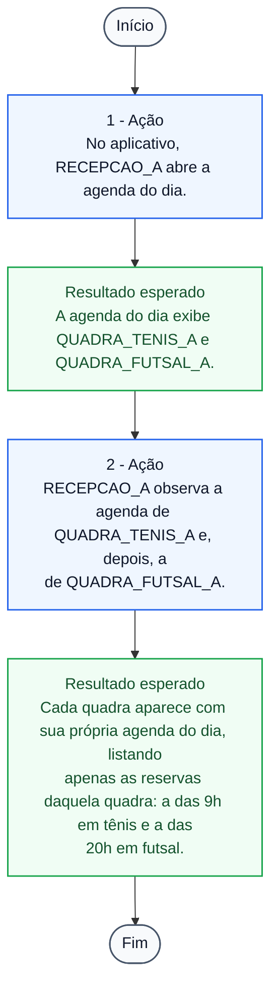

# TC-014 - Recepção vê a agenda do dia de cada quadra

**Status:** NEEDS_REVIEW  
**Prioridade:** HIGH  
**Tipo:** FUNCTIONAL  
**Família de cenários:** Agenda do dia

**Base do teste:** ACCEPTANCE  
**Tipo primário:** FUNCTIONAL  
**Adequação à automação:** MEDIUM  
**Prontidão para automação:** NEEDS_POLICY  
**Camada:** UI  
**Pendências:** UNRESOLVED_PERMISSION, MISSING_SELECTOR  
**Perguntas:** Q-009

## Objetivo
Confirmar que a recepção consulta a agenda do dia separada por quadra, com as reservas de cada uma.

## Pré-condições
- RECEPCAO_A é um usuário da recepção com acesso ao aplicativo
- Existem reservas no mesmo dia: uma em QUADRA_TENIS_A às 9h e outra em QUADRA_FUTSAL_A às 20h

## Dados de teste
- **RECEPCAO_A:** usuário da recepção com sessão aberta
- **QUADRA_TENIS_A:** quadra de tênis com uma reserva às 9h
- **QUADRA_FUTSAL_A:** quadra de futsal com uma reserva às 20h

## Passos
| # | Ação | Resultado esperado | Esclarecimento |
|---:|---|---|:---:|
| 1 | No aplicativo, RECEPCAO_A abre a agenda do dia. | A agenda do dia exibe QUADRA_TENIS_A e QUADRA_FUTSAL_A. | Não |
| 2 | RECEPCAO_A observa a agenda de QUADRA_TENIS_A e, depois, a de QUADRA_FUTSAL_A. | Cada quadra aparece com sua própria agenda do dia, listando apenas as reservas daquela quadra: a das 9h em tênis e a das 20h em futsal. | Não |

## Pós-condições
- Nenhum

## Limpeza
- Nenhum

## Restauração de estado
REQUIRES_FIXTURE_RESET — o harness deve reiniciar as fixtures de Dados de teste antes do próximo caso

## Rastreabilidade
- Requisitos: REQ-006
- Coverage points: CP-017
- Fontes: `sources/prd.md` (Requisitos, item 5 (linha 11))

## Artefato JSON
`test-cases/TC-014.json`

## Fluxo do Teste

