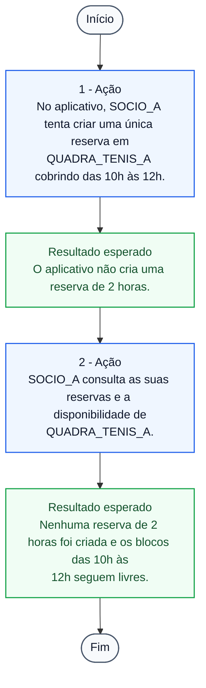

# TC-015 - Recusar pedido único de reserva com 2 horas de duração

**Status:** NEEDS_REVIEW  
**Prioridade:** HIGH  
**Tipo:** NEGATIVE  
**Família de cenários:** Reserva de quadra

**Base do teste:** DERIVED  
**Tipo primário:** NEGATIVE  
**Dimensão:** NEGATIVE  
**Adequação à automação:** MEDIUM  
**Prontidão para automação:** NEEDS_POLICY  
**Camada:** UI  
**Pendências:** MISSING_EXECUTION_SURFACE, AMBIGUOUS_POLICY  
**Perguntas:** Q-004

## Objetivo
Verificar que o aplicativo não cria uma reserva única maior que o bloco de 1 hora.

## Pré-condições
- SOCIO_A é sócio ativo com sessão aberta e sem reservas futuras
- QUADRA_TENIS_A está livre das 10h às 12h de uma data futura

## Dados de teste
- **SOCIO_A:** sócio ativo sem reservas futuras
- **QUADRA_TENIS_A:** quadra de tênis livre das 10h às 12h

## Passos
| # | Ação | Resultado esperado | Esclarecimento |
|---:|---|---|:---:|
| 1 | No aplicativo, SOCIO_A tenta criar uma única reserva em QUADRA_TENIS_A cobrindo das 10h às 12h. | O aplicativo não cria uma reserva de 2 horas. | Não |
| 2 | SOCIO_A consulta as suas reservas e a disponibilidade de QUADRA_TENIS_A. | Nenhuma reserva de 2 horas foi criada e os blocos das 10h às 12h seguem livres. | Não |

## Pós-condições
- SOCIO_A sem reservas futuras

## Limpeza
- Nenhum

## Restauração de estado
REQUIRES_FIXTURE_RESET — o harness deve reiniciar as fixtures de Dados de teste antes do próximo caso

## Rastreabilidade
- Requisitos: REQ-002
- Coverage points: CP-006
- Fontes: `sources/prd.md` (Requisitos, item 1 (linha 7)), `sources/prd.md` (Requisitos, item 1 (linha 7): blocos de 1 hora)

## Artefato JSON
`test-cases/TC-015.json`

## Fluxo do Teste

