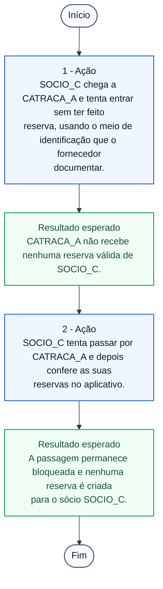

# TC-016 - Catraca não libera sócio que não reservou a quadra

**Status:** EXPLORATORY  
**Prioridade:** HIGH  
**Tipo:** HARDWARE_INTEGRATION  
**Família de cenários:** Acesso pela catraca

**Base do teste:** EXPLORATORY  
**Tipo primário:** HARDWARE_INTEGRATION  
**Dimensão:** NEGATIVE  
**Adequação à automação:** MANUAL_ONLY  
**Prontidão para automação:** NOT_APPLICABLE  
**Camada:** HARDWARE  
**Pendências:** EXTERNAL_DEPENDENCY_UNAVAILABLE, MISSING_EXECUTION_SURFACE, BLOCKING_QUESTION  
**Perguntas:** Q-002

## Objetivo
Caracterizar que a entrada só acontece com reserva, protegendo o acesso físico às quadras.

## Pré-condições
- SOCIO_C é sócio ativo sem nenhuma reserva para o bloco em andamento
- CATRACA_A está em operação
- O contrato da API do fornecedor de catracas não foi entregue

## Dados de teste
- **SOCIO_C:** sócio ativo sem reserva para o horário atual
- **CATRACA_A:** catraca de acesso às quadras

## Passos
| # | Ação | Resultado esperado | Esclarecimento |
|---:|---|---|:---:|
| 1 | SOCIO_C chega a CATRACA_A e tenta entrar sem ter feito reserva, usando o meio de identificação que o fornecedor documentar. | CATRACA_A não recebe nenhuma reserva válida de SOCIO_C. | Não |
| 2 | SOCIO_C tenta passar por CATRACA_A e depois confere as suas reservas no aplicativo. | A passagem permanece bloqueada e nenhuma reserva é criada para o sócio SOCIO_C. | Não |

## Pós-condições
- SOCIO_C fora da área das quadras, sem reservas

## Limpeza
- Nenhum

## Restauração de estado
REQUIRES_FIXTURE_RESET — o harness deve reiniciar as fixtures de Dados de teste antes do próximo caso

## Rastreabilidade
- Requisitos: REQ-005
- Coverage points: CP-015
- Fontes: `sources/prd.md` (Requisitos, item 4 (linha 10))

## Artefato JSON
`test-cases/TC-016.json`

## Fluxo do Teste

