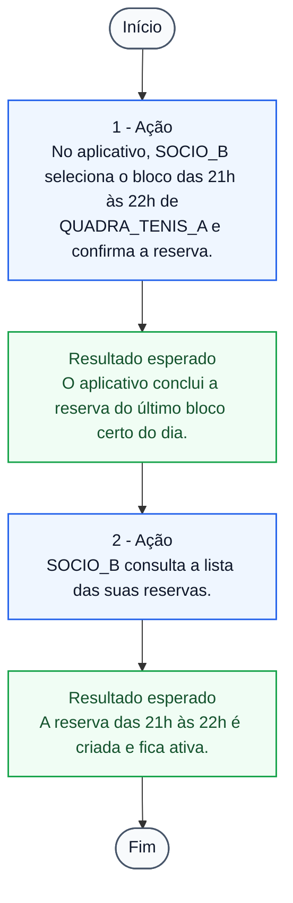

# TC-018 - Aceitar o bloco que termina às 22h

**Status:** READY  
**Prioridade:** HIGH  
**Tipo:** BOUNDARY  
**Família de cenários:** Janela de horário

**Base do teste:** DERIVED  
**Tipo primário:** BOUNDARY  
**Dimensão:** BOUNDARY  
**Adequação à automação:** HIGH  
**Prontidão para automação:** NEEDS_SELECTOR  
**Camada:** UI  
**Pendências:** MISSING_SELECTOR

## Objetivo
Verificar o limite superior seguro da janela: um bloco que termina exatamente às 22h.

## Pré-condições
- SOCIO_B é sócio ativo com sessão aberta e sem reservas futuras
- QUADRA_TENIS_A está livre das 21h às 22h de uma data futura

## Dados de teste
- **SOCIO_B:** sócio ativo sem reservas futuras
- **QUADRA_TENIS_A:** quadra de tênis livre das 21h às 22h

## Passos
| # | Ação | Resultado esperado | Esclarecimento |
|---:|---|---|:---:|
| 1 | No aplicativo, SOCIO_B seleciona o bloco das 21h às 22h de QUADRA_TENIS_A e confirma a reserva. | O aplicativo conclui a reserva do último bloco certo do dia. | Não |
| 2 | SOCIO_B consulta a lista das suas reservas. | A reserva das 21h às 22h é criada e fica ativa. | Não |

## Pós-condições
- Reserva ativa das 21h às 22h

## Limpeza
- Cancelar a reserva

## Restauração de estado
SELF_CLEANING — o próprio caso limpa (ver Limpeza)

## Rastreabilidade
- Requisitos: REQ-002
- Coverage points: CP-007
- Fontes: `sources/prd.md` (Requisitos, item 1 (linha 7)), `sources/prd.md` (Requisitos, item 1 (linha 7): entre 7h e 22h)

## Artefato JSON
`test-cases/TC-018.json`

## Fluxo do Teste

