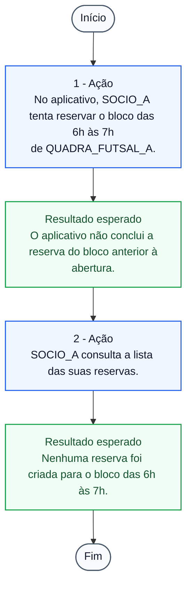

# TC-019 - Recusar bloco que começa uma hora antes da abertura

**Status:** NEEDS_REVIEW  
**Prioridade:** MEDIUM  
**Tipo:** BOUNDARY  
**Família de cenários:** Janela de horário

**Base do teste:** DERIVED  
**Tipo primário:** BOUNDARY  
**Dimensão:** BOUNDARY  
**Adequação à automação:** HIGH  
**Prontidão para automação:** NEEDS_POLICY  
**Camada:** UI  
**Pendências:** AMBIGUOUS_POLICY, MISSING_SELECTOR  
**Perguntas:** Q-004

## Objetivo
Verificar que o bloco imediatamente anterior à janela não é aceito.

## Pré-condições
- SOCIO_A é sócio ativo com sessão aberta e sem reservas futuras
- QUADRA_FUTSAL_A não tem reservas entre 6h e 7h de uma data futura

## Dados de teste
- **SOCIO_A:** sócio ativo sem reservas futuras
- **QUADRA_FUTSAL_A:** quadra de futsal sem reservas de manhã cedo

## Passos
| # | Ação | Resultado esperado | Esclarecimento |
|---:|---|---|:---:|
| 1 | No aplicativo, SOCIO_A tenta reservar o bloco das 6h às 7h de QUADRA_FUTSAL_A. | O aplicativo não conclui a reserva do bloco anterior à abertura. | Não |
| 2 | SOCIO_A consulta a lista das suas reservas. | Nenhuma reserva foi criada para o bloco das 6h às 7h. | Não |

## Pós-condições
- SOCIO_A sem reservas futuras

## Limpeza
- Nenhum

## Restauração de estado
REQUIRES_FIXTURE_RESET — o harness deve reiniciar as fixtures de Dados de teste antes do próximo caso

## Rastreabilidade
- Requisitos: REQ-002
- Coverage points: CP-008
- Fontes: `sources/prd.md` (Requisitos, item 1 (linha 7)), `sources/prd.md` (Requisitos, item 1 (linha 7): entre 7h e 22h)

## Artefato JSON
`test-cases/TC-019.json`

## Fluxo do Teste

