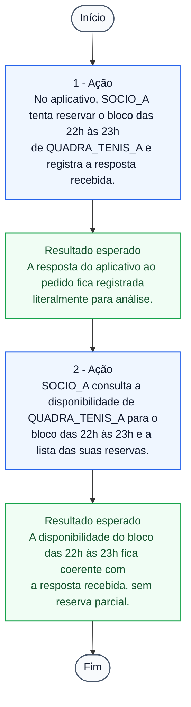

# TC-020 - Caracterizar o bloco que começa às 22h

**Status:** EXPLORATORY  
**Prioridade:** MEDIUM  
**Tipo:** BOUNDARY  
**Família de cenários:** Janela de horário

**Base do teste:** EXPLORATORY  
**Tipo primário:** BOUNDARY  
**Dimensão:** BOUNDARY  
**Adequação à automação:** LOW  
**Prontidão para automação:** NEEDS_POLICY  
**Camada:** UI  
**Pendências:** MISSING_ORACLE  
**Perguntas:** Q-003

## Objetivo
Registrar como o aplicativo trata o bloco das 22h às 23h, enquanto a ambiguidade do limite não é resolvida.

## Pré-condições
- SOCIO_A é sócio ativo com sessão aberta e sem reservas futuras
- QUADRA_TENIS_A não tem reservas às 22h de uma data futura
- O PRD não define se um bloco que começa às 22h é permitido

## Dados de teste
- **SOCIO_A:** sócio ativo sem reservas futuras
- **QUADRA_TENIS_A:** quadra de tênis sem reservas das 22h às 23h

## Passos
| # | Ação | Resultado esperado | Esclarecimento |
|---:|---|---|:---:|
| 1 | No aplicativo, SOCIO_A tenta reservar o bloco das 22h às 23h de QUADRA_TENIS_A e registra a resposta recebida. | A resposta do aplicativo ao pedido fica registrada literalmente para análise. | Não |
| 2 | SOCIO_A consulta a disponibilidade de QUADRA_TENIS_A para o bloco das 22h às 23h e a lista das suas reservas. | A disponibilidade do bloco das 22h às 23h fica coerente com a resposta recebida, sem reserva parcial. | Não |

## Pós-condições
- Estado do bloco das 22h registrado

## Limpeza
- Cancelar a reserva, se tiver sido criada

## Restauração de estado
SELF_CLEANING — o próprio caso limpa (ver Limpeza)

## Rastreabilidade
- Requisitos: REQ-002
- Coverage points: CP-008
- Fontes: `sources/prd.md` (Requisitos, item 1 (linha 7)), `sources/prd.md` (Requisitos, item 1 (linha 7): entre 7h e 22h)

## Artefato JSON
`test-cases/TC-020.json`

## Fluxo do Teste

