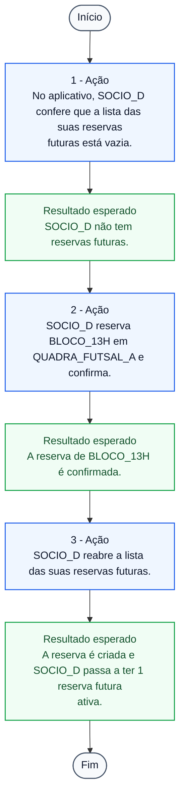

# TC-021 - Primeira reserva de um sócio sem reservas futuras

**Status:** READY  
**Prioridade:** MEDIUM  
**Tipo:** BOUNDARY  
**Família de cenários:** Limite de reservas futuras

**Base do teste:** DERIVED  
**Tipo primário:** BOUNDARY  
**Dimensão:** BOUNDARY  
**Adequação à automação:** HIGH  
**Prontidão para automação:** NEEDS_SELECTOR  
**Camada:** UI  
**Pendências:** MISSING_SELECTOR

## Objetivo
Verificar o limite inferior do contador de reservas futuras, com zero reservas.

## Pré-condições
- SOCIO_D é sócio ativo com sessão aberta e nenhuma reserva futura
- QUADRA_FUTSAL_A está livre no bloco BLOCO_13H de uma data futura

## Dados de teste
- **SOCIO_D:** sócio ativo com 0 reservas futuras
- **QUADRA_FUTSAL_A:** quadra de futsal livre em BLOCO_13H
- **BLOCO_13H:** bloco das 13h às 14h de uma data futura

## Passos
| # | Ação | Resultado esperado | Esclarecimento |
|---:|---|---|:---:|
| 1 | No aplicativo, SOCIO_D confere que a lista das suas reservas futuras está vazia. | SOCIO_D não tem reservas futuras. | Não |
| 2 | SOCIO_D reserva BLOCO_13H em QUADRA_FUTSAL_A e confirma. | A reserva de BLOCO_13H é confirmada. | Não |
| 3 | SOCIO_D reabre a lista das suas reservas futuras. | A reserva é criada e SOCIO_D passa a ter 1 reserva futura ativa. | Não |

## Pós-condições
- SOCIO_D com 1 reserva futura

## Limpeza
- Cancelar a reserva

## Restauração de estado
SELF_CLEANING — o próprio caso limpa (ver Limpeza)

## Rastreabilidade
- Requisitos: REQ-003
- Coverage points: CP-010
- Fontes: `sources/prd.md` (Requisitos, item 2 (linha 8))

## Artefato JSON
`test-cases/TC-021.json`

## Fluxo do Teste

