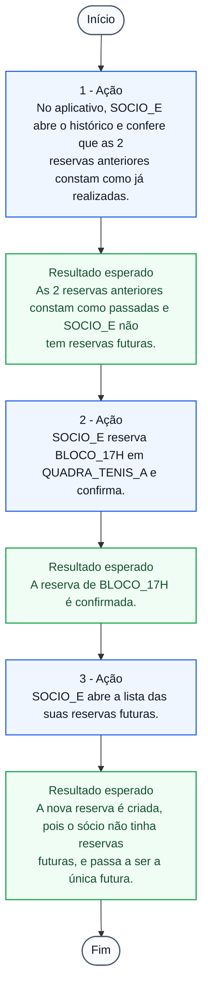

# TC-022 - Reservas passadas não consomem o limite de futuras

**Status:** NEEDS_REVIEW  
**Prioridade:** HIGH  
**Tipo:** BOUNDARY  
**Família de cenários:** Limite de reservas futuras

**Base do teste:** DERIVED  
**Tipo primário:** BOUNDARY  
**Dimensão:** BOUNDARY  
**Adequação à automação:** MEDIUM  
**Prontidão para automação:** NEEDS_FIXTURE  
**Camada:** UI  
**Pendências:** UNKNOWN_SETUP_PATH, MISSING_SELECTOR

## Objetivo
Verificar que apenas reservas futuras entram no limite de 2.

## Pré-condições
- SOCIO_E é sócio ativo com sessão aberta
- SOCIO_E tem 2 reservas cujo horário já passou e nenhuma reserva futura
- QUADRA_TENIS_A está livre em BLOCO_17H de uma data futura
- A criação das reservas passadas depende de massa de dados do ambiente de teste, cuja forma não é conhecida

## Dados de teste
- **SOCIO_E:** sócio ativo com 2 reservas já realizadas e 0 futuras
- **QUADRA_TENIS_A:** quadra de tênis livre em BLOCO_17H
- **BLOCO_17H:** bloco das 17h às 18h de uma data futura

## Passos
| # | Ação | Resultado esperado | Esclarecimento |
|---:|---|---|:---:|
| 1 | No aplicativo, SOCIO_E abre o histórico e confere que as 2 reservas anteriores constam como já realizadas. | As 2 reservas anteriores constam como passadas e SOCIO_E não tem reservas futuras. | Não |
| 2 | SOCIO_E reserva BLOCO_17H em QUADRA_TENIS_A e confirma. | A reserva de BLOCO_17H é confirmada. | Não |
| 3 | SOCIO_E abre a lista das suas reservas futuras. | A nova reserva é criada, pois o sócio não tinha reservas futuras, e passa a ser a única futura. | Não |

## Pós-condições
- SOCIO_E com 1 reserva futura

## Limpeza
- Cancelar a nova reserva

## Restauração de estado
SELF_CLEANING — o próprio caso limpa (ver Limpeza)

## Rastreabilidade
- Requisitos: REQ-003
- Coverage points: CP-010
- Fontes: `sources/prd.md` (Requisitos, item 2 (linha 8)), `sources/prd.md` (Requisitos, item 2 (linha 8): reservas futuras)

## Artefato JSON
`test-cases/TC-022.json`

## Fluxo do Teste

