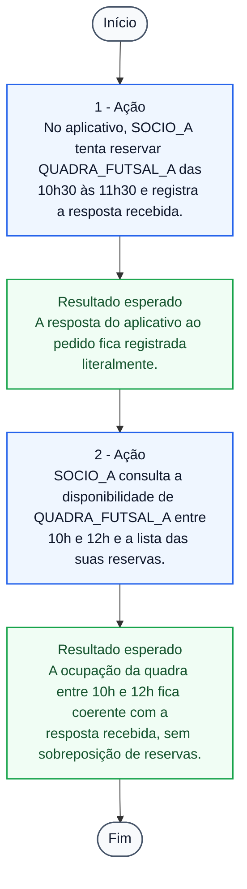

# TC-023 - Caracterizar pedido com início fora da hora cheia

**Status:** EXPLORATORY  
**Prioridade:** MEDIUM  
**Tipo:** BOUNDARY  
**Família de cenários:** Reserva de quadra

**Base do teste:** EXPLORATORY  
**Tipo primário:** BOUNDARY  
**Dimensão:** BOUNDARY  
**Adequação à automação:** LOW  
**Prontidão para automação:** NEEDS_POLICY  
**Camada:** UI  
**Pendências:** MISSING_ORACLE, MISSING_EXECUTION_SURFACE  
**Perguntas:** Q-005

## Objetivo
Registrar como o aplicativo trata um bloco de 1 hora que começa às 10h30.

## Pré-condições
- SOCIO_A é sócio ativo com sessão aberta e sem reservas futuras
- QUADRA_FUTSAL_A está livre das 10h às 12h de uma data futura
- O PRD não define se o início do bloco precisa estar na hora cheia

## Dados de teste
- **SOCIO_A:** sócio ativo sem reservas futuras
- **QUADRA_FUTSAL_A:** quadra de futsal livre das 10h às 12h

## Passos
| # | Ação | Resultado esperado | Esclarecimento |
|---:|---|---|:---:|
| 1 | No aplicativo, SOCIO_A tenta reservar QUADRA_FUTSAL_A das 10h30 às 11h30 e registra a resposta recebida. | A resposta do aplicativo ao pedido fica registrada literalmente. | Não |
| 2 | SOCIO_A consulta a disponibilidade de QUADRA_FUTSAL_A entre 10h e 12h e a lista das suas reservas. | A ocupação da quadra entre 10h e 12h fica coerente com a resposta recebida, sem sobreposição de reservas. | Não |

## Pós-condições
- Estado registrado

## Limpeza
- Cancelar a reserva, se tiver sido criada

## Restauração de estado
SELF_CLEANING — o próprio caso limpa (ver Limpeza)

## Rastreabilidade
- Requisitos: REQ-002
- Coverage points: CP-006
- Fontes: `sources/prd.md` (Requisitos, item 1 (linha 7)), `sources/prd.md` (Requisitos, item 1 (linha 7): blocos de 1 hora)

## Artefato JSON
`test-cases/TC-023.json`

## Fluxo do Teste

