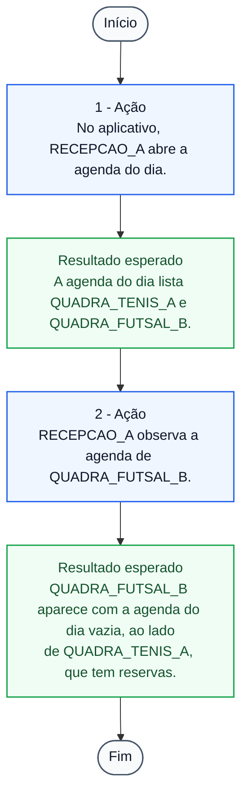

# TC-024 - Agenda do dia de quadra sem reservas aparece vazia

**Status:** NEEDS_REVIEW  
**Prioridade:** MEDIUM  
**Tipo:** BOUNDARY  
**Família de cenários:** Agenda do dia

**Base do teste:** DERIVED  
**Tipo primário:** BOUNDARY  
**Dimensão:** BOUNDARY  
**Adequação à automação:** MEDIUM  
**Prontidão para automação:** NEEDS_POLICY  
**Camada:** UI  
**Pendências:** UNRESOLVED_PERMISSION, MISSING_SELECTOR  
**Perguntas:** Q-009

## Objetivo
Verificar que cada quadra tem agenda, mesmo sem reservas no dia.

## Pré-condições
- RECEPCAO_A é usuário da recepção com acesso ao aplicativo
- QUADRA_TENIS_A tem reservas no dia
- QUADRA_FUTSAL_B não tem nenhuma reserva no mesmo dia

## Dados de teste
- **RECEPCAO_A:** usuário da recepção com sessão aberta
- **QUADRA_TENIS_A:** quadra de tênis com reservas no dia
- **QUADRA_FUTSAL_B:** quadra de futsal sem reservas no dia

## Passos
| # | Ação | Resultado esperado | Esclarecimento |
|---:|---|---|:---:|
| 1 | No aplicativo, RECEPCAO_A abre a agenda do dia. | A agenda do dia lista QUADRA_TENIS_A e QUADRA_FUTSAL_B. | Não |
| 2 | RECEPCAO_A observa a agenda de QUADRA_FUTSAL_B. | QUADRA_FUTSAL_B aparece com a agenda do dia vazia, ao lado de QUADRA_TENIS_A, que tem reservas. | Não |

## Pós-condições
- Nenhum

## Limpeza
- Nenhum

## Restauração de estado
REQUIRES_FIXTURE_RESET — o harness deve reiniciar as fixtures de Dados de teste antes do próximo caso

## Rastreabilidade
- Requisitos: REQ-006
- Coverage points: CP-017
- Fontes: `sources/prd.md` (Requisitos, item 5 (linha 11))

## Artefato JSON
`test-cases/TC-024.json`

## Fluxo do Teste

