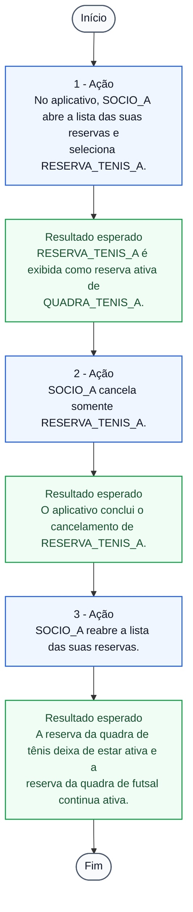

# TC-025 - Cancelar uma de duas reservas preserva a outra

**Status:** NEEDS_REVIEW  
**Prioridade:** HIGH  
**Tipo:** STATE_TRANSITION  
**Família de cenários:** Cancelamento

**Base do teste:** DERIVED  
**Tipo primário:** STATE_TRANSITION  
**Dimensão:** OPERATOR_ERROR  
**Adequação à automação:** HIGH  
**Prontidão para automação:** NEEDS_POLICY  
**Camada:** UI  
**Pendências:** AMBIGUOUS_POLICY, MISSING_SELECTOR, BLOCKING_QUESTION  
**Perguntas:** Q-001

## Objetivo
Verificar que o cancelamento afeta somente a reserva escolhida.

## Pré-condições
- SOCIO_A é sócio ativo com sessão aberta
- SOCIO_A tem 2 reservas futuras ativas: RESERVA_TENIS_A em QUADRA_TENIS_A e RESERVA_FUTSAL_A em QUADRA_FUTSAL_A, ambas com grande antecedência

## Dados de teste
- **SOCIO_A:** sócio titular das duas reservas
- **RESERVA_TENIS_A:** reserva futura ativa em QUADRA_TENIS_A
- **RESERVA_FUTSAL_A:** reserva futura ativa em QUADRA_FUTSAL_A
- **QUADRA_TENIS_A:** quadra de tênis da primeira reserva
- **QUADRA_FUTSAL_A:** quadra de futsal da segunda reserva

## Passos
| # | Ação | Resultado esperado | Esclarecimento |
|---:|---|---|:---:|
| 1 | No aplicativo, SOCIO_A abre a lista das suas reservas e seleciona RESERVA_TENIS_A. | RESERVA_TENIS_A é exibida como reserva ativa de QUADRA_TENIS_A. | Não |
| 2 | SOCIO_A cancela somente RESERVA_TENIS_A. | O aplicativo conclui o cancelamento de RESERVA_TENIS_A. | Não |
| 3 | SOCIO_A reabre a lista das suas reservas. | A reserva da quadra de tênis deixa de estar ativa e a reserva da quadra de futsal continua ativa. | Não |

## Pós-condições
- Apenas RESERVA_FUTSAL_A ativa

## Limpeza
- Cancelar RESERVA_FUTSAL_A

## Restauração de estado
SELF_CLEANING — o próprio caso limpa (ver Limpeza)

## Rastreabilidade
- Requisitos: REQ-004
- Coverage points: CP-012
- Fontes: `sources/prd.md` (Requisitos, item 3 (linha 9))

## Artefato JSON
`test-cases/TC-025.json`

## Fluxo do Teste

