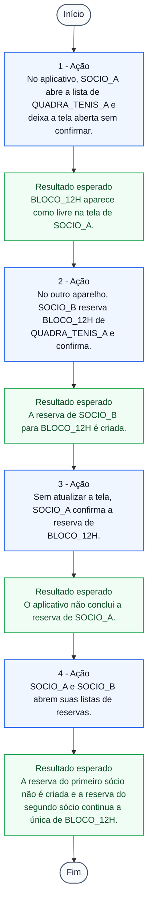

# TC-026 - Confirmar bloco exibido como livre que outro sócio já reservou

**Status:** NEEDS_REVIEW  
**Prioridade:** HIGH  
**Tipo:** NEGATIVE  
**Família de cenários:** Reserva de quadra

**Base do teste:** DERIVED  
**Tipo primário:** NEGATIVE  
**Dimensão:** OPERATOR_ERROR  
**Adequação à automação:** MEDIUM  
**Prontidão para automação:** NEEDS_POLICY  
**Camada:** UI  
**Pendências:** AMBIGUOUS_POLICY, MISSING_SELECTOR  
**Perguntas:** Q-004

## Objetivo
Verificar a recusa quando a tela do sócio está desatualizada.

## Pré-condições
- SOCIO_A e SOCIO_B são sócios ativos sem reservas futuras, cada um com sessão aberta em seu aparelho
- QUADRA_TENIS_A está livre em BLOCO_12H de uma data futura

## Dados de teste
- **SOCIO_A:** primeiro sócio, com a lista de horários aberta e desatualizada
- **SOCIO_B:** segundo sócio, que reserva antes
- **QUADRA_TENIS_A:** quadra de tênis disputada
- **BLOCO_12H:** bloco das 12h às 13h de uma data futura

## Passos
| # | Ação | Resultado esperado | Esclarecimento |
|---:|---|---|:---:|
| 1 | No aplicativo, SOCIO_A abre a lista de QUADRA_TENIS_A e deixa a tela aberta sem confirmar. | BLOCO_12H aparece como livre na tela de SOCIO_A. | Não |
| 2 | No outro aparelho, SOCIO_B reserva BLOCO_12H de QUADRA_TENIS_A e confirma. | A reserva de SOCIO_B para BLOCO_12H é criada. | Não |
| 3 | Sem atualizar a tela, SOCIO_A confirma a reserva de BLOCO_12H. | O aplicativo não conclui a reserva de SOCIO_A. | Não |
| 4 | SOCIO_A e SOCIO_B abrem suas listas de reservas. | A reserva do primeiro sócio não é criada e a reserva do segundo sócio continua a única de BLOCO_12H. | Não |

## Pós-condições
- BLOCO_12H reservado somente por SOCIO_B

## Limpeza
- Cancelar a reserva de SOCIO_B

## Restauração de estado
SELF_CLEANING — o próprio caso limpa (ver Limpeza)

## Rastreabilidade
- Requisitos: REQ-002
- Coverage points: CP-005
- Fontes: `sources/prd.md` (Requisitos, item 1 (linha 7))

## Artefato JSON
`test-cases/TC-026.json`

## Fluxo do Teste

