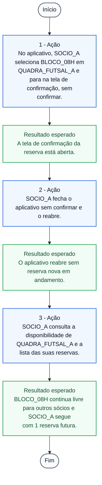

# TC-027 - Reserva abandonada sem confirmar não ocupa o bloco

**Status:** READY  
**Prioridade:** MEDIUM  
**Tipo:** STATE_TRANSITION  
**Família de cenários:** Reserva de quadra

**Base do teste:** DERIVED  
**Tipo primário:** STATE_TRANSITION  
**Dimensão:** OPERATOR_ERROR  
**Adequação à automação:** MEDIUM  
**Prontidão para automação:** NEEDS_SELECTOR  
**Camada:** UI  
**Pendências:** MISSING_SELECTOR

## Objetivo
Verificar que escolher um bloco sem confirmar não o bloqueia nem consome o limite do sócio.

## Pré-condições
- SOCIO_A é sócio ativo com sessão aberta e 1 reserva futura ativa
- QUADRA_FUTSAL_A está livre em BLOCO_08H de uma data futura

## Dados de teste
- **SOCIO_A:** sócio ativo com 1 reserva futura
- **QUADRA_FUTSAL_A:** quadra de futsal livre em BLOCO_08H
- **BLOCO_08H:** bloco das 8h às 9h de uma data futura

## Passos
| # | Ação | Resultado esperado | Esclarecimento |
|---:|---|---|:---:|
| 1 | No aplicativo, SOCIO_A seleciona BLOCO_08H em QUADRA_FUTSAL_A e para na tela de confirmação, sem confirmar. | A tela de confirmação da reserva está aberta. | Não |
| 2 | SOCIO_A fecha o aplicativo sem confirmar e o reabre. | O aplicativo reabre sem reserva nova em andamento. | Não |
| 3 | SOCIO_A consulta a disponibilidade de QUADRA_FUTSAL_A e a lista das suas reservas. | BLOCO_08H continua livre para outros sócios e SOCIO_A segue com 1 reserva futura. | Não |

## Pós-condições
- SOCIO_A com 1 reserva futura

## Limpeza
- Cancelar a reserva existente

## Restauração de estado
SELF_CLEANING — o próprio caso limpa (ver Limpeza)

## Rastreabilidade
- Requisitos: REQ-002
- Coverage points: CP-004
- Fontes: `sources/prd.md` (Requisitos, item 1 (linha 7))

## Artefato JSON
`test-cases/TC-027.json`

## Fluxo do Teste

