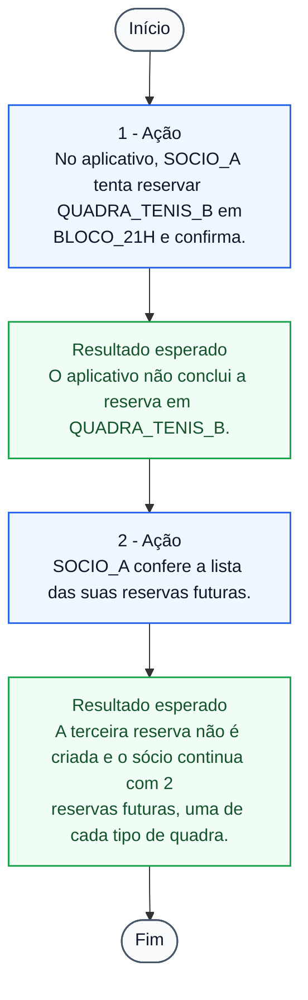

# TC-028 - Limite de 2 vale somando tênis e futsal

**Status:** NEEDS_REVIEW  
**Prioridade:** HIGH  
**Tipo:** NEGATIVE  
**Família de cenários:** Limite de reservas futuras

**Base do teste:** DERIVED  
**Tipo primário:** NEGATIVE  
**Dimensão:** MISUSE  
**Adequação à automação:** HIGH  
**Prontidão para automação:** NEEDS_POLICY  
**Camada:** UI  
**Pendências:** AMBIGUOUS_POLICY, MISSING_SELECTOR  
**Perguntas:** Q-004

## Objetivo
Verificar que o limite é por sócio e não por tipo de quadra.

## Pré-condições
- SOCIO_A é sócio ativo com sessão aberta
- SOCIO_A tem 1 reserva futura em QUADRA_TENIS_A e 1 em QUADRA_FUTSAL_A
- QUADRA_TENIS_B está livre em BLOCO_21H de uma data futura

## Dados de teste
- **SOCIO_A:** sócio ativo com uma reserva de cada tipo de quadra
- **QUADRA_TENIS_A:** quadra de tênis da primeira reserva
- **QUADRA_FUTSAL_A:** quadra de futsal da segunda reserva
- **QUADRA_TENIS_B:** outra quadra de tênis, livre em BLOCO_21H
- **BLOCO_21H:** bloco das 21h às 22h de uma data futura

## Passos
| # | Ação | Resultado esperado | Esclarecimento |
|---:|---|---|:---:|
| 1 | No aplicativo, SOCIO_A tenta reservar QUADRA_TENIS_B em BLOCO_21H e confirma. | O aplicativo não conclui a reserva em QUADRA_TENIS_B. | Não |
| 2 | SOCIO_A confere a lista das suas reservas futuras. | A terceira reserva não é criada e o sócio continua com 2 reservas futuras, uma de cada tipo de quadra. | Não |

## Pós-condições
- SOCIO_A com 2 reservas futuras

## Limpeza
- Cancelar as 2 reservas

## Restauração de estado
SELF_CLEANING — o próprio caso limpa (ver Limpeza)

## Rastreabilidade
- Requisitos: REQ-003
- Coverage points: CP-011
- Fontes: `sources/prd.md` (Requisitos, item 2 (linha 8))

## Artefato JSON
`test-cases/TC-028.json`

## Fluxo do Teste

