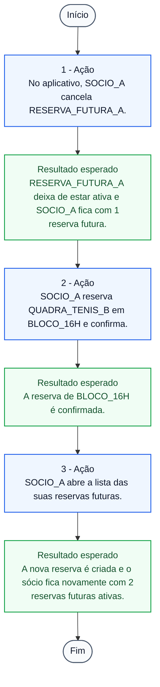

# TC-029 - Cancelamento devolve ao sócio uma vaga no limite de reservas

**Status:** NEEDS_REVIEW  
**Prioridade:** HIGH  
**Tipo:** STATE_TRANSITION  
**Família de cenários:** Limite de reservas futuras

**Base do teste:** DERIVED  
**Tipo primário:** STATE_TRANSITION  
**Dimensão:** STATE_TRANSITION  
**Adequação à automação:** HIGH  
**Prontidão para automação:** NEEDS_POLICY  
**Camada:** UI  
**Pendências:** AMBIGUOUS_POLICY, MISSING_SELECTOR, BLOCKING_QUESTION  
**Perguntas:** Q-001

## Objetivo
Verificar que a reserva cancelada deixa de contar entre as 2 futuras.

## Pré-condições
- SOCIO_A é sócio ativo com sessão aberta e exatamente 2 reservas futuras ativas, ambas com grande antecedência
- QUADRA_TENIS_B está livre em BLOCO_16H de uma data futura

## Dados de teste
- **SOCIO_A:** sócio no limite de 2 reservas futuras
- **RESERVA_FUTURA_A:** uma das 2 reservas ativas, a ser cancelada
- **QUADRA_TENIS_B:** quadra de tênis livre em BLOCO_16H
- **BLOCO_16H:** bloco das 16h às 17h de uma data futura

## Passos
| # | Ação | Resultado esperado | Esclarecimento |
|---:|---|---|:---:|
| 1 | No aplicativo, SOCIO_A cancela RESERVA_FUTURA_A. | RESERVA_FUTURA_A deixa de estar ativa e SOCIO_A fica com 1 reserva futura. | Não |
| 2 | SOCIO_A reserva QUADRA_TENIS_B em BLOCO_16H e confirma. | A reserva de BLOCO_16H é confirmada. | Não |
| 3 | SOCIO_A abre a lista das suas reservas futuras. | A nova reserva é criada e o sócio fica novamente com 2 reservas futuras ativas. | Não |

## Pós-condições
- SOCIO_A com 2 reservas futuras

## Limpeza
- Cancelar as 2 reservas

## Restauração de estado
SELF_CLEANING — o próprio caso limpa (ver Limpeza)

## Rastreabilidade
- Requisitos: REQ-003, REQ-004
- Coverage points: CP-011, CP-012
- Fontes: `sources/prd.md` (Requisitos, item 2 (linha 8)), `sources/prd.md` (Requisitos, item 3 (linha 9)), `sources/prd.md` (Requisitos, itens 2 e 3 (linhas 8 e 9))

## Artefato JSON
`test-cases/TC-029.json`

## Fluxo do Teste

