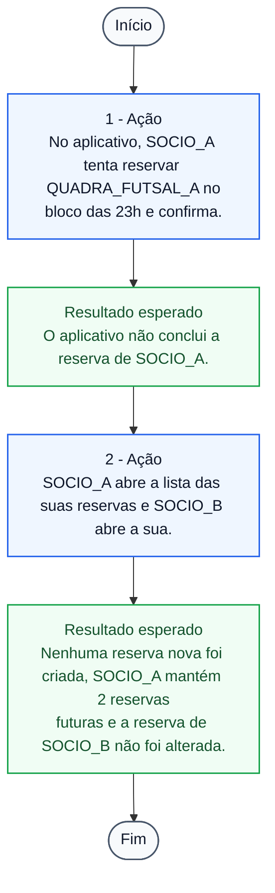

# TC-030 - Pedido com vários motivos de recusa ao mesmo tempo

**Status:** NEEDS_REVIEW  
**Prioridade:** MEDIUM  
**Tipo:** NEGATIVE  
**Família de cenários:** Reserva de quadra

**Base do teste:** DERIVED  
**Tipo primário:** NEGATIVE  
**Dimensão:** DECISION_TABLE  
**Adequação à automação:** LOW  
**Prontidão para automação:** NEEDS_POLICY  
**Camada:** UI  
**Pendências:** UNKNOWN_SETUP_PATH, AMBIGUOUS_POLICY  
**Perguntas:** Q-004

## Objetivo
Verificar que combinar regras violadas continua sem criar reserva nem alterar o limite.

## Pré-condições
- SOCIO_A é sócio ativo com sessão aberta e 2 reservas futuras ativas
- SOCIO_B tem uma reserva ativa em QUADRA_FUTSAL_A no bloco das 23h
- O bloco das 23h está fora da janela e já reservado: a reserva de SOCIO_B existe por preparação de dados do ambiente

## Dados de teste
- **SOCIO_A:** sócio no limite de 2 reservas
- **SOCIO_B:** sócio titular da reserva existente
- **QUADRA_FUTSAL_A:** quadra de futsal com reserva fora da janela

## Passos
| # | Ação | Resultado esperado | Esclarecimento |
|---:|---|---|:---:|
| 1 | No aplicativo, SOCIO_A tenta reservar QUADRA_FUTSAL_A no bloco das 23h e confirma. | O aplicativo não conclui a reserva de SOCIO_A. | Não |
| 2 | SOCIO_A abre a lista das suas reservas e SOCIO_B abre a sua. | Nenhuma reserva nova foi criada, SOCIO_A mantém 2 reservas futuras e a reserva de SOCIO_B não foi alterada. | Não |

## Pós-condições
- Estados inalterados

## Limpeza
- Cancelar as reservas criadas na preparação

## Restauração de estado
SELF_CLEANING — o próprio caso limpa (ver Limpeza)

## Rastreabilidade
- Requisitos: REQ-002, REQ-003
- Coverage points: CP-005, CP-008, CP-011
- Fontes: `sources/prd.md` (Requisitos, item 1 (linha 7)), `sources/prd.md` (Requisitos, item 2 (linha 8)), `sources/prd.md` (Requisitos, itens 1 e 2 (linhas 7 e 8))

## Artefato JSON
`test-cases/TC-030.json`

## Fluxo do Teste

