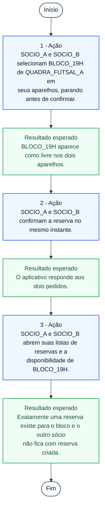

# TC-031 - Dois sócios disputam o mesmo bloco ao mesmo tempo

**Status:** NEEDS_REVIEW  
**Prioridade:** CRITICAL  
**Tipo:** CONCURRENCY  
**Família de cenários:** Reserva de quadra

**Base do teste:** DERIVED  
**Tipo primário:** CONCURRENCY  
**Dimensão:** CONCURRENCY  
**Adequação à automação:** LOW  
**Prontidão para automação:** NEEDS_POLICY  
**Camada:** MIXED  
**Pendências:** UNKNOWN_SETUP_PATH, AMBIGUOUS_POLICY  
**Perguntas:** Q-004

## Objetivo
Garantir que apenas um dos pedidos simultâneos vença a disputa pelo bloco.

## Pré-condições
- SOCIO_A e SOCIO_B são sócios ativos sem reservas futuras, cada um com sessão aberta em seu aparelho
- QUADRA_FUTSAL_A está livre em BLOCO_19H de uma data futura
- O mecanismo para disparar duas confirmações no mesmo instante não é conhecido

## Dados de teste
- **SOCIO_A:** primeiro sócio da disputa
- **SOCIO_B:** segundo sócio da disputa
- **QUADRA_FUTSAL_A:** quadra de futsal livre
- **BLOCO_19H:** bloco das 19h às 20h de uma data futura

## Passos
| # | Ação | Resultado esperado | Esclarecimento |
|---:|---|---|:---:|
| 1 | SOCIO_A e SOCIO_B selecionam BLOCO_19H de QUADRA_FUTSAL_A em seus aparelhos, parando antes de confirmar. | BLOCO_19H aparece como livre nos dois aparelhos. | Não |
| 2 | SOCIO_A e SOCIO_B confirmam a reserva no mesmo instante. | O aplicativo responde aos dois pedidos. | Não |
| 3 | SOCIO_A e SOCIO_B abrem suas listas de reservas e a disponibilidade de BLOCO_19H. | Exatamente uma reserva existe para o bloco e o outro sócio não fica com reserva criada. | Não |

## Pós-condições
- BLOCO_19H com uma única reserva

## Limpeza
- Cancelar a reserva criada

## Restauração de estado
SELF_CLEANING — o próprio caso limpa (ver Limpeza)

## Rastreabilidade
- Requisitos: REQ-002
- Coverage points: CP-005
- Fontes: `sources/prd.md` (Requisitos, item 1 (linha 7))

## Artefato JSON
`test-cases/TC-031.json`

## Fluxo do Teste

