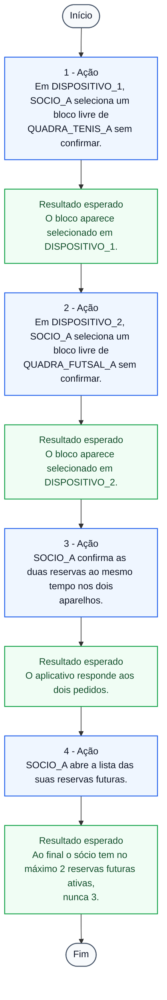

# TC-032 - Pedidos simultâneos não furam o limite de 2 reservas

**Status:** NEEDS_REVIEW  
**Prioridade:** HIGH  
**Tipo:** RACE_CONDITION  
**Família de cenários:** Limite de reservas futuras

**Base do teste:** DERIVED  
**Tipo primário:** RACE_CONDITION  
**Dimensão:** RACE_CONDITION  
**Adequação à automação:** LOW  
**Prontidão para automação:** NEEDS_POLICY  
**Camada:** MIXED  
**Pendências:** UNKNOWN_SETUP_PATH, AMBIGUOUS_POLICY  
**Perguntas:** Q-004

## Objetivo
Verificar que a checagem do limite resiste a pedidos em paralelo.

## Pré-condições
- SOCIO_A é sócio ativo com 1 reserva futura ativa e sessão aberta em dois aparelhos, DISPOSITIVO_1 e DISPOSITIVO_2
- QUADRA_TENIS_A e QUADRA_FUTSAL_A têm blocos livres distintos em uma data futura
- A forma de disparar os dois pedidos ao mesmo tempo não é conhecida

## Dados de teste
- **SOCIO_A:** sócio com 1 reserva futura
- **DISPOSITIVO_1:** primeiro aparelho do sócio, apontando para um bloco de QUADRA_TENIS_A
- **DISPOSITIVO_2:** segundo aparelho do sócio, apontando para um bloco de QUADRA_FUTSAL_A
- **QUADRA_TENIS_A:** quadra de tênis com bloco livre
- **QUADRA_FUTSAL_A:** quadra de futsal com bloco livre

## Passos
| # | Ação | Resultado esperado | Esclarecimento |
|---:|---|---|:---:|
| 1 | Em DISPOSITIVO_1, SOCIO_A seleciona um bloco livre de QUADRA_TENIS_A sem confirmar. | O bloco aparece selecionado em DISPOSITIVO_1. | Não |
| 2 | Em DISPOSITIVO_2, SOCIO_A seleciona um bloco livre de QUADRA_FUTSAL_A sem confirmar. | O bloco aparece selecionado em DISPOSITIVO_2. | Não |
| 3 | SOCIO_A confirma as duas reservas ao mesmo tempo nos dois aparelhos. | O aplicativo responde aos dois pedidos. | Não |
| 4 | SOCIO_A abre a lista das suas reservas futuras. | Ao final o sócio tem no máximo 2 reservas futuras ativas, nunca 3. | Não |

## Pós-condições
- SOCIO_A com no máximo 2 reservas futuras

## Limpeza
- Cancelar todas as reservas de SOCIO_A

## Restauração de estado
SELF_CLEANING — o próprio caso limpa (ver Limpeza)

## Rastreabilidade
- Requisitos: REQ-003
- Coverage points: CP-011
- Fontes: `sources/prd.md` (Requisitos, item 2 (linha 8))

## Artefato JSON
`test-cases/TC-032.json`

## Fluxo do Teste

