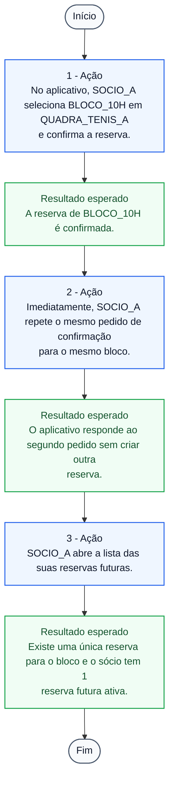

# TC-033 - Confirmar duas vezes a mesma reserva gera uma só

**Status:** NEEDS_REVIEW  
**Prioridade:** HIGH  
**Tipo:** IDEMPOTENCY  
**Família de cenários:** Reserva de quadra

**Base do teste:** DERIVED  
**Tipo primário:** IDEMPOTENCY  
**Dimensão:** IDEMPOTENCY  
**Adequação à automação:** MEDIUM  
**Prontidão para automação:** NEEDS_POLICY  
**Camada:** UI  
**Pendências:** AMBIGUOUS_POLICY, MISSING_SELECTOR  
**Perguntas:** Q-004

## Objetivo
Verificar que o pedido repetido do mesmo sócio não duplica a reserva nem o conta duas vezes no limite.

## Pré-condições
- SOCIO_A é sócio ativo com sessão aberta e sem reservas futuras
- QUADRA_TENIS_A está livre em BLOCO_10H de uma data futura

## Dados de teste
- **SOCIO_A:** sócio ativo sem reservas futuras
- **QUADRA_TENIS_A:** quadra de tênis livre em BLOCO_10H
- **BLOCO_10H:** bloco das 10h às 11h de uma data futura

## Passos
| # | Ação | Resultado esperado | Esclarecimento |
|---:|---|---|:---:|
| 1 | No aplicativo, SOCIO_A seleciona BLOCO_10H em QUADRA_TENIS_A e confirma a reserva. | A reserva de BLOCO_10H é confirmada. | Não |
| 2 | Imediatamente, SOCIO_A repete o mesmo pedido de confirmação para o mesmo bloco. | O aplicativo responde ao segundo pedido sem criar outra reserva. | Não |
| 3 | SOCIO_A abre a lista das suas reservas futuras. | Existe uma única reserva para o bloco e o sócio tem 1 reserva futura ativa. | Não |

## Pós-condições
- 1 reserva ativa

## Limpeza
- Cancelar a reserva

## Restauração de estado
SELF_CLEANING — o próprio caso limpa (ver Limpeza)

## Rastreabilidade
- Requisitos: REQ-002
- Coverage points: CP-005
- Fontes: `sources/prd.md` (Requisitos, item 1 (linha 7)), `sources/prd.md` (Requisitos, itens 1 e 2 (linhas 7 e 8))

## Artefato JSON
`test-cases/TC-033.json`

## Fluxo do Teste

