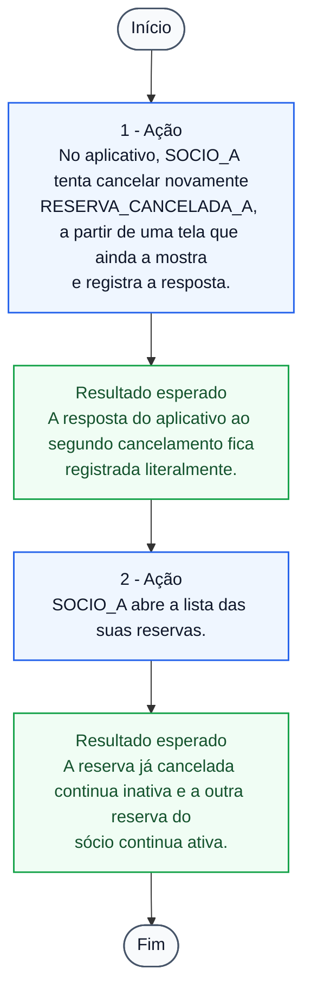

# TC-034 - Caracterizar o cancelamento de uma reserva já cancelada

**Status:** EXPLORATORY  
**Prioridade:** MEDIUM  
**Tipo:** IDEMPOTENCY  
**Família de cenários:** Cancelamento

**Base do teste:** EXPLORATORY  
**Tipo primário:** IDEMPOTENCY  
**Dimensão:** IDEMPOTENCY  
**Adequação à automação:** LOW  
**Prontidão para automação:** NEEDS_POLICY  
**Camada:** UI  
**Pendências:** MISSING_ORACLE, MISSING_EXECUTION_SURFACE  
**Perguntas:** Q-007

## Objetivo
Registrar o comportamento do aplicativo ao receber um segundo cancelamento e proteger o estado das outras reservas.

## Pré-condições
- SOCIO_A é sócio ativo com sessão aberta
- SOCIO_A cancelou RESERVA_CANCELADA_A e tem outra reserva futura ativa, RESERVA_ATIVA_A
- O PRD não define a resposta a um segundo cancelamento

## Dados de teste
- **SOCIO_A:** sócio titular das duas reservas
- **RESERVA_CANCELADA_A:** reserva já cancelada pelo titular
- **RESERVA_ATIVA_A:** outra reserva futura ativa de SOCIO_A

## Passos
| # | Ação | Resultado esperado | Esclarecimento |
|---:|---|---|:---:|
| 1 | No aplicativo, SOCIO_A tenta cancelar novamente RESERVA_CANCELADA_A, a partir de uma tela que ainda a mostra e registra a resposta. | A resposta do aplicativo ao segundo cancelamento fica registrada literalmente. | Não |
| 2 | SOCIO_A abre a lista das suas reservas. | A reserva já cancelada continua inativa e a outra reserva do sócio continua ativa. | Não |

## Pós-condições
- RESERVA_ATIVA_A ativa

## Limpeza
- Cancelar RESERVA_ATIVA_A

## Restauração de estado
SELF_CLEANING — o próprio caso limpa (ver Limpeza)

## Rastreabilidade
- Requisitos: REQ-004
- Coverage points: CP-012
- Fontes: `sources/prd.md` (Requisitos, item 3 (linha 9))

## Artefato JSON
`test-cases/TC-034.json`

## Fluxo do Teste

