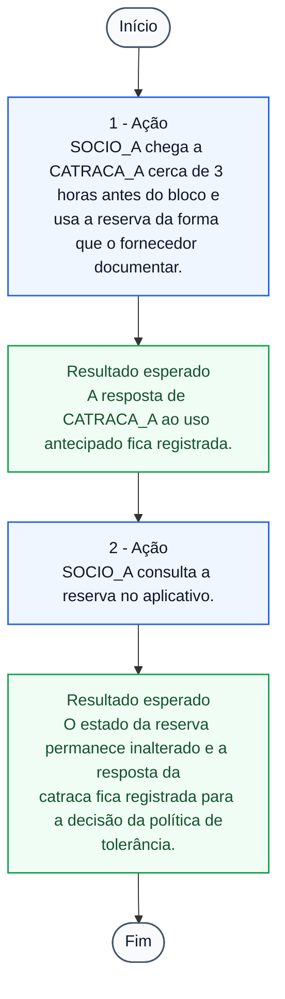

# TC-035 - Caracterizar a entrada na catraca antes do horário reservado

**Status:** EXPLORATORY  
**Prioridade:** MEDIUM  
**Tipo:** HARDWARE_INTEGRATION  
**Família de cenários:** Acesso pela catraca

**Base do teste:** EXPLORATORY  
**Tipo primário:** HARDWARE_INTEGRATION  
**Dimensão:** INTEGRATION  
**Adequação à automação:** MANUAL_ONLY  
**Prontidão para automação:** NOT_APPLICABLE  
**Camada:** HARDWARE  
**Pendências:** MISSING_ORACLE, EXTERNAL_DEPENDENCY_UNAVAILABLE, BLOCKING_QUESTION  
**Perguntas:** Q-002, Q-008

## Objetivo
Registrar como a catraca trata a chegada antes do início do bloco da reserva.

## Pré-condições
- SOCIO_A é sócio ativo com reserva ativa em QUADRA_TENIS_A que só começa daqui a 3 horas
- CATRACA_A está em operação
- A tolerância de horário da catraca e o contrato da API não são conhecidos

## Dados de teste
- **SOCIO_A:** sócio titular de reserva que começa em 3 horas
- **QUADRA_TENIS_A:** quadra de tênis da reserva futura
- **CATRACA_A:** catraca de acesso às quadras

## Passos
| # | Ação | Resultado esperado | Esclarecimento |
|---:|---|---|:---:|
| 1 | SOCIO_A chega a CATRACA_A cerca de 3 horas antes do bloco e usa a reserva da forma que o fornecedor documentar. | A resposta de CATRACA_A ao uso antecipado fica registrada. | Não |
| 2 | SOCIO_A consulta a reserva no aplicativo. | O estado da reserva permanece inalterado e a resposta da catraca fica registrada para a decisão da política de tolerância. | Não |

## Pós-condições
- Reserva ainda ativa

## Limpeza
- Cancelar a reserva

## Restauração de estado
SELF_CLEANING — o próprio caso limpa (ver Limpeza)

## Rastreabilidade
- Requisitos: REQ-005
- Coverage points: CP-015
- Fontes: `sources/prd.md` (Requisitos, item 4 (linha 10))

## Artefato JSON
`test-cases/TC-035.json`

## Fluxo do Teste

