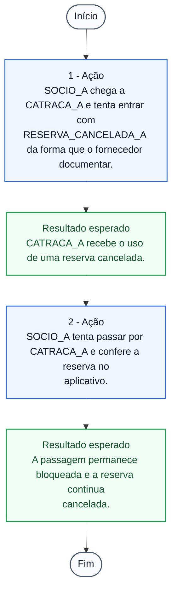

# TC-036 - Catraca não libera quem usa uma reserva cancelada

**Status:** EXPLORATORY  
**Prioridade:** HIGH  
**Tipo:** HARDWARE_INTEGRATION  
**Família de cenários:** Acesso pela catraca

**Base do teste:** EXPLORATORY  
**Tipo primário:** HARDWARE_INTEGRATION  
**Dimensão:** INTEGRATION  
**Adequação à automação:** MANUAL_ONLY  
**Prontidão para automação:** NOT_APPLICABLE  
**Camada:** HARDWARE  
**Pendências:** EXTERNAL_DEPENDENCY_UNAVAILABLE, MISSING_EXECUTION_SURFACE, BLOCKING_QUESTION  
**Perguntas:** Q-002

## Objetivo
Caracterizar que a reserva cancelada deixa de dar acesso.

## Pré-condições
- SOCIO_A é sócio ativo que cancelou a reserva do bloco em andamento
- CATRACA_A está em operação
- A API do fornecedor de catracas não está documentada

## Dados de teste
- **SOCIO_A:** sócio cuja reserva foi cancelada
- **CATRACA_A:** catraca de acesso às quadras
- **RESERVA_CANCELADA_A:** reserva do bloco atual, cancelada pelo titular

## Passos
| # | Ação | Resultado esperado | Esclarecimento |
|---:|---|---|:---:|
| 1 | SOCIO_A chega a CATRACA_A e tenta entrar com RESERVA_CANCELADA_A da forma que o fornecedor documentar. | CATRACA_A recebe o uso de uma reserva cancelada. | Não |
| 2 | SOCIO_A tenta passar por CATRACA_A e confere a reserva no aplicativo. | A passagem permanece bloqueada e a reserva continua cancelada. | Não |

## Pós-condições
- SOCIO_A fora da área das quadras

## Limpeza
- Nenhum

## Restauração de estado
REQUIRES_FIXTURE_RESET — o harness deve reiniciar as fixtures de Dados de teste antes do próximo caso

## Rastreabilidade
- Requisitos: REQ-004, REQ-005
- Coverage points: CP-012, CP-015
- Fontes: `sources/prd.md` (Requisitos, item 3 (linha 9)), `sources/prd.md` (Requisitos, item 4 (linha 10)), `sources/prd.md` (Requisitos, itens 3 e 4 (linhas 9 e 10))

## Artefato JSON
`test-cases/TC-036.json`

## Fluxo do Teste

