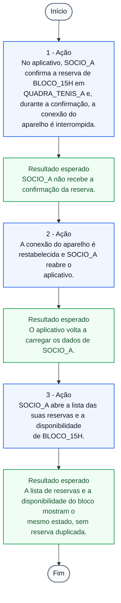

# TC-037 - Conexão perdida ao confirmar e restabelecida em seguida

**Status:** EXPLORATORY  
**Prioridade:** MEDIUM  
**Tipo:** RECOVERY  
**Família de cenários:** Reserva de quadra

**Base do teste:** EXPLORATORY  
**Tipo primário:** RECOVERY  
**Dimensão:** RECOVERY  
**Adequação à automação:** LOW  
**Prontidão para automação:** NEEDS_POLICY  
**Camada:** MIXED  
**Pendências:** UNKNOWN_SETUP_PATH, MISSING_ORACLE  
**Perguntas:** Q-007

## Objetivo
Verificar que, depois de voltar a conexão, o sócio vê um estado coerente: a reserva existe uma vez ou não existe.

## Pré-condições
- SOCIO_A é sócio ativo com sessão aberta e sem reservas futuras
- QUADRA_TENIS_A está livre em BLOCO_15H de uma data futura
- A forma de interromper e restabelecer a conexão do aparelho não é conhecida

## Dados de teste
- **SOCIO_A:** sócio ativo sem reservas futuras
- **QUADRA_TENIS_A:** quadra de tênis livre em BLOCO_15H
- **BLOCO_15H:** bloco das 15h às 16h de uma data futura

## Passos
| # | Ação | Resultado esperado | Esclarecimento |
|---:|---|---|:---:|
| 1 | No aplicativo, SOCIO_A confirma a reserva de BLOCO_15H em QUADRA_TENIS_A e, durante a confirmação, a conexão do aparelho é interrompida. | SOCIO_A não recebe a confirmação da reserva. | Não |
| 2 | A conexão do aparelho é restabelecida e SOCIO_A reabre o aplicativo. | O aplicativo volta a carregar os dados de SOCIO_A. | Não |
| 3 | SOCIO_A abre a lista das suas reservas e a disponibilidade de BLOCO_15H. | A lista de reservas e a disponibilidade do bloco mostram o mesmo estado, sem reserva duplicada. | Não |

## Pós-condições
- Estado coerente

## Limpeza
- Cancelar a reserva, se existir

## Restauração de estado
SELF_CLEANING — o próprio caso limpa (ver Limpeza)

## Rastreabilidade
- Requisitos: REQ-002
- Coverage points: CP-003
- Fontes: `sources/prd.md` (Requisitos, item 1 (linha 7))

## Artefato JSON
`test-cases/TC-037.json`

## Fluxo do Teste

