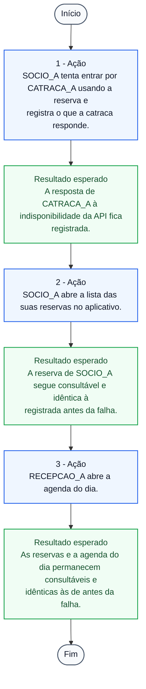

# TC-038 - API de catracas indisponível não altera reservas nem agenda

**Status:** EXPLORATORY  
**Prioridade:** HIGH  
**Tipo:** CHAOS  
**Família de cenários:** Acesso pela catraca

**Base do teste:** EXPLORATORY  
**Tipo primário:** CHAOS  
**Dimensão:** CHAOS  
**Adequação à automação:** LOW  
**Prontidão para automação:** NEEDS_POLICY  
**Camada:** INTEGRATION  
**Pendências:** UNKNOWN_SETUP_PATH, EXTERNAL_DEPENDENCY_UNAVAILABLE, MISSING_ORACLE, BLOCKING_QUESTION  
**Perguntas:** Q-002, Q-010

## Objetivo
Garantir que a falha do fornecedor não corrompe as reservas nem a agenda da recepção.

## Pré-condições
- SOCIO_A tem reserva ativa para o bloco em andamento e RECEPCAO_A tem acesso ao aplicativo
- A API do fornecedor de catracas está indisponível, sem técnica conhecida para provocar ou simular essa indisponibilidade
- Foi registrado o estado das reservas e da agenda antes da falha

## Dados de teste
- **SOCIO_A:** sócio titular da reserva em andamento
- **RECEPCAO_A:** usuário da recepção com sessão aberta
- **CATRACA_A:** catraca cuja API do fornecedor está indisponível

## Passos
| # | Ação | Resultado esperado | Esclarecimento |
|---:|---|---|:---:|
| 1 | SOCIO_A tenta entrar por CATRACA_A usando a reserva e registra o que a catraca responde. | A resposta de CATRACA_A à indisponibilidade da API fica registrada. | Não |
| 2 | SOCIO_A abre a lista das suas reservas no aplicativo. | A reserva de SOCIO_A segue consultável e idêntica à registrada antes da falha. | Não |
| 3 | RECEPCAO_A abre a agenda do dia. | As reservas e a agenda do dia permanecem consultáveis e idênticas às de antes da falha. | Não |

## Pós-condições
- Reservas inalteradas

## Limpeza
- Restabelecer a API do fornecedor

## Restauração de estado
SELF_CLEANING — o próprio caso limpa (ver Limpeza)

## Rastreabilidade
- Requisitos: REQ-005
- Coverage points: CP-015
- Fontes: `sources/prd.md` (Requisitos, item 4 (linha 10)), `sources/prd.md` (Requisitos, itens 4 e 5 (linhas 10 e 11))

## Artefato JSON
`test-cases/TC-038.json`

## Fluxo do Teste

