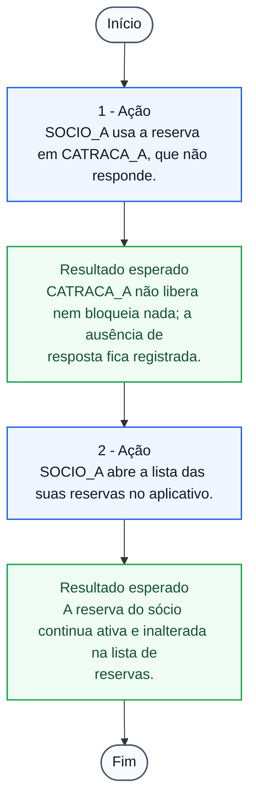

# TC-039 - Catraca com defeito não perde a reserva do sócio

**Status:** EXPLORATORY  
**Prioridade:** MEDIUM  
**Tipo:** HARDWARE_INTEGRATION  
**Família de cenários:** Acesso pela catraca

**Base do teste:** EXPLORATORY  
**Tipo primário:** HARDWARE_INTEGRATION  
**Dimensão:** CHAOS  
**Adequação à automação:** MANUAL_ONLY  
**Prontidão para automação:** NOT_APPLICABLE  
**Camada:** HARDWARE  
**Pendências:** UNKNOWN_SETUP_PATH, MISSING_ORACLE  
**Perguntas:** Q-010

## Objetivo
Caracterizar o efeito de um equipamento sem resposta sobre a reserva do sócio.

## Pré-condições
- SOCIO_A tem reserva ativa para o bloco em andamento
- CATRACA_A está sem resposta por defeito físico; a técnica para reproduzir esse defeito não é conhecida

## Dados de teste
- **SOCIO_A:** sócio titular da reserva em andamento
- **CATRACA_A:** catraca da quadra, com defeito e sem responder

## Passos
| # | Ação | Resultado esperado | Esclarecimento |
|---:|---|---|:---:|
| 1 | SOCIO_A usa a reserva em CATRACA_A, que não responde. | CATRACA_A não libera nem bloqueia nada; a ausência de resposta fica registrada. | Não |
| 2 | SOCIO_A abre a lista das suas reservas no aplicativo. | A reserva do sócio continua ativa e inalterada na lista de reservas. | Não |

## Pós-condições
- Reserva ativa

## Limpeza
- Reparar CATRACA_A

## Restauração de estado
SELF_CLEANING — o próprio caso limpa (ver Limpeza)

## Rastreabilidade
- Requisitos: REQ-005
- Coverage points: CP-015
- Fontes: `sources/prd.md` (Requisitos, item 4 (linha 10))

## Artefato JSON
`test-cases/TC-039.json`

## Fluxo do Teste

