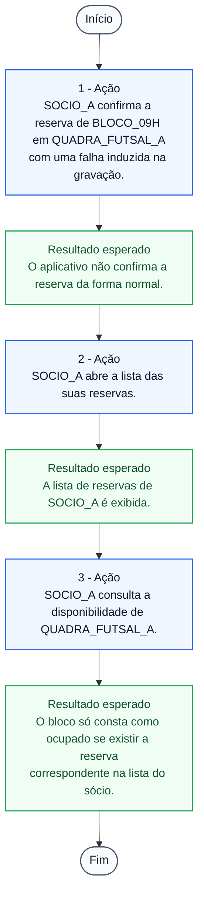

# TC-040 - Falha parcial na confirmação não deixa bloco preso sem reserva

**Status:** EXPLORATORY  
**Prioridade:** HIGH  
**Tipo:** DATA_INTEGRITY  
**Família de cenários:** Reserva de quadra

**Base do teste:** EXPLORATORY  
**Tipo primário:** DATA_INTEGRITY  
**Dimensão:** CHAOS  
**Adequação à automação:** LOW  
**Prontidão para automação:** NEEDS_POLICY  
**Camada:** MIXED  
**Pendências:** UNKNOWN_SETUP_PATH, MISSING_ORACLE  
**Perguntas:** Q-007

## Objetivo
Verificar a consistência entre a reserva e a disponibilidade do bloco quando a confirmação falha pela metade.

## Pré-condições
- SOCIO_A é sócio ativo com sessão aberta e sem reservas futuras
- QUADRA_FUTSAL_A está livre em BLOCO_09H de uma data futura
- A forma de induzir falha de gravação no meio da confirmação é desconhecida

## Dados de teste
- **SOCIO_A:** sócio ativo sem reservas futuras
- **QUADRA_FUTSAL_A:** quadra de futsal livre em BLOCO_09H
- **BLOCO_09H:** bloco das 9h às 10h de uma data futura

## Passos
| # | Ação | Resultado esperado | Esclarecimento |
|---:|---|---|:---:|
| 1 | SOCIO_A confirma a reserva de BLOCO_09H em QUADRA_FUTSAL_A com uma falha induzida na gravação. | O aplicativo não confirma a reserva da forma normal. | Não |
| 2 | SOCIO_A abre a lista das suas reservas. | A lista de reservas de SOCIO_A é exibida. | Não |
| 3 | SOCIO_A consulta a disponibilidade de QUADRA_FUTSAL_A. | O bloco só consta como ocupado se existir a reserva correspondente na lista do sócio. | Não |

## Pós-condições
- Bloco e reserva coerentes

## Limpeza
- Cancelar a reserva, se existir

## Restauração de estado
SELF_CLEANING — o próprio caso limpa (ver Limpeza)

## Rastreabilidade
- Requisitos: REQ-002
- Coverage points: CP-004
- Fontes: `sources/prd.md` (Requisitos, item 1 (linha 7))

## Artefato JSON
`test-cases/TC-040.json`

## Fluxo do Teste

