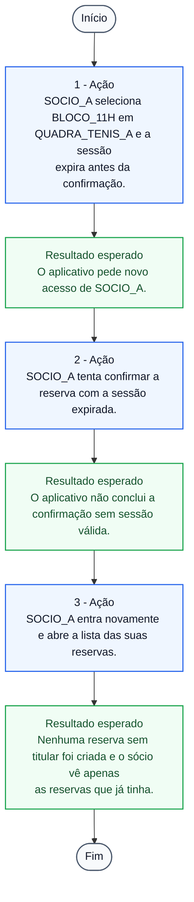

# TC-041 - Sessão expirada durante a reserva não deixa reserva sem titular

**Status:** EXPLORATORY  
**Prioridade:** MEDIUM  
**Tipo:** RESILIENCE  
**Família de cenários:** Reserva de quadra

**Base do teste:** EXPLORATORY  
**Tipo primário:** RESILIENCE  
**Dimensão:** CHAOS  
**Adequação à automação:** LOW  
**Prontidão para automação:** NEEDS_POLICY  
**Camada:** UI  
**Pendências:** UNKNOWN_SETUP_PATH, MISSING_ORACLE  
**Perguntas:** Q-007

## Objetivo
Verificar que, se a sessão acaba antes de confirmar, nenhuma reserva fica sem titular.

## Pré-condições
- SOCIO_A é sócio ativo com 1 reserva futura ativa e sessão aberta no aplicativo
- QUADRA_TENIS_A está livre em BLOCO_11H de uma data futura
- A forma de expirar a sessão antes da confirmação é desconhecida

## Dados de teste
- **SOCIO_A:** sócio ativo com 1 reserva futura
- **QUADRA_TENIS_A:** quadra de tênis livre em BLOCO_11H
- **BLOCO_11H:** bloco das 11h às 12h de uma data futura

## Passos
| # | Ação | Resultado esperado | Esclarecimento |
|---:|---|---|:---:|
| 1 | SOCIO_A seleciona BLOCO_11H em QUADRA_TENIS_A e a sessão expira antes da confirmação. | O aplicativo pede novo acesso de SOCIO_A. | Não |
| 2 | SOCIO_A tenta confirmar a reserva com a sessão expirada. | O aplicativo não conclui a confirmação sem sessão válida. | Não |
| 3 | SOCIO_A entra novamente e abre a lista das suas reservas. | Nenhuma reserva sem titular foi criada e o sócio vê apenas as reservas que já tinha. | Não |

## Pós-condições
- SOCIO_A com 1 reserva futura

## Limpeza
- Cancelar a reserva existente

## Restauração de estado
SELF_CLEANING — o próprio caso limpa (ver Limpeza)

## Rastreabilidade
- Requisitos: REQ-002
- Coverage points: CP-003
- Fontes: `sources/prd.md` (Requisitos, item 1 (linha 7))

## Artefato JSON
`test-cases/TC-041.json`

## Fluxo do Teste

