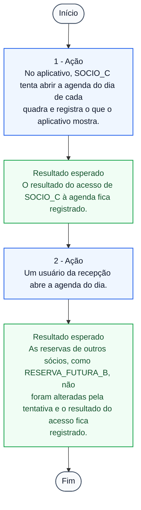

# TC-042 - Sócio comum tentando abrir a agenda da recepção

**Status:** EXPLORATORY  
**Prioridade:** MEDIUM  
**Tipo:** SECURITY  
**Família de cenários:** Agenda do dia

**Base do teste:** EXPLORATORY  
**Tipo primário:** SECURITY  
**Dimensão:** SECURITY  
**Adequação à automação:** MEDIUM  
**Prontidão para automação:** NEEDS_POLICY  
**Camada:** UI  
**Pendências:** UNRESOLVED_PERMISSION, MISSING_ORACLE  
**Perguntas:** Q-009

## Objetivo
Caracterizar se a agenda do dia, feita para a recepção, fica exposta a quem não é da recepção.

## Pré-condições
- SOCIO_C é sócio comum, sem perfil de recepção, com sessão aberta
- Existem reservas de outros sócios no dia, como RESERVA_FUTURA_B
- O PRD não define quem além da recepção pode ver a agenda

## Dados de teste
- **SOCIO_C:** sócio comum sem perfil de recepção
- **RESERVA_FUTURA_B:** reserva ativa de outro sócio no dia

## Passos
| # | Ação | Resultado esperado | Esclarecimento |
|---:|---|---|:---:|
| 1 | No aplicativo, SOCIO_C tenta abrir a agenda do dia de cada quadra e registra o que o aplicativo mostra. | O resultado do acesso de SOCIO_C à agenda fica registrado. | Não |
| 2 | Um usuário da recepção abre a agenda do dia. | As reservas de outros sócios, como RESERVA_FUTURA_B, não foram alteradas pela tentativa e o resultado do acesso fica registrado. | Não |

## Pós-condições
- Reservas inalteradas

## Limpeza
- Nenhum

## Restauração de estado
REQUIRES_FIXTURE_RESET — o harness deve reiniciar as fixtures de Dados de teste antes do próximo caso

## Rastreabilidade
- Requisitos: REQ-006
- Coverage points: CP-017
- Fontes: `sources/prd.md` (Requisitos, item 5 (linha 11))

## Artefato JSON
`test-cases/TC-042.json`

## Fluxo do Teste

