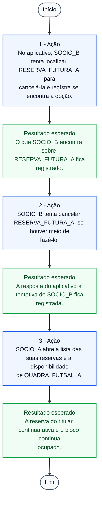

# TC-043 - Sócio tenta cancelar a reserva de outro sócio

**Status:** EXPLORATORY  
**Prioridade:** CRITICAL  
**Tipo:** AUTHORIZATION  
**Família de cenários:** Cancelamento

**Base do teste:** EXPLORATORY  
**Tipo primário:** AUTHORIZATION  
**Dimensão:** AUTHORIZATION  
**Adequação à automação:** MEDIUM  
**Prontidão para automação:** NEEDS_POLICY  
**Camada:** UI  
**Pendências:** UNRESOLVED_PERMISSION, MISSING_EXECUTION_SURFACE  
**Perguntas:** Q-006

## Objetivo
Caracterizar a proteção da reserva alheia contra cancelamento por quem não é titular.

## Pré-condições
- SOCIO_A é titular de RESERVA_FUTURA_A, ativa e com grande antecedência
- SOCIO_B é sócio ativo com sessão aberta e não é titular dessa reserva
- O PRD não define se outros sócios podem cancelar a reserva alheia

## Dados de teste
- **SOCIO_A:** titular da reserva
- **SOCIO_B:** sócio que não é titular
- **RESERVA_FUTURA_A:** reserva ativa de SOCIO_A em QUADRA_FUTSAL_A
- **QUADRA_FUTSAL_A:** quadra de futsal da reserva

## Passos
| # | Ação | Resultado esperado | Esclarecimento |
|---:|---|---|:---:|
| 1 | No aplicativo, SOCIO_B tenta localizar RESERVA_FUTURA_A para cancelá-la e registra se encontra a opção. | O que SOCIO_B encontra sobre RESERVA_FUTURA_A fica registrado. | Não |
| 2 | SOCIO_B tenta cancelar RESERVA_FUTURA_A, se houver meio de fazê-lo. | A resposta do aplicativo à tentativa de SOCIO_B fica registrada. | Não |
| 3 | SOCIO_A abre a lista das suas reservas e a disponibilidade de QUADRA_FUTSAL_A. | A reserva do titular continua ativa e o bloco continua ocupado. | Não |

## Pós-condições
- RESERVA_FUTURA_A ativa

## Limpeza
- Cancelar RESERVA_FUTURA_A

## Restauração de estado
SELF_CLEANING — o próprio caso limpa (ver Limpeza)

## Rastreabilidade
- Requisitos: REQ-004
- Coverage points: CP-012
- Fontes: `sources/prd.md` (Requisitos, item 3 (linha 9))

## Artefato JSON
`test-cases/TC-043.json`

## Fluxo do Teste

