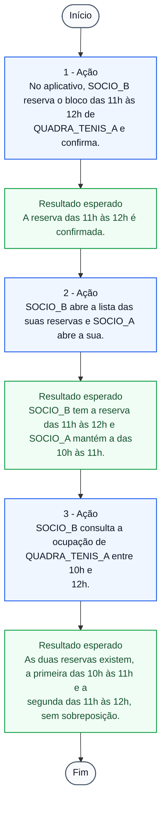

# TC-044 - Blocos adjacentes da mesma quadra não se sobrepõem

**Status:** READY  
**Prioridade:** MEDIUM  
**Tipo:** DATA_INTEGRITY  
**Família de cenários:** Reserva de quadra

**Base do teste:** DERIVED  
**Tipo primário:** DATA_INTEGRITY  
**Dimensão:** DATA_INTEGRITY  
**Adequação à automação:** HIGH  
**Prontidão para automação:** NEEDS_SELECTOR  
**Camada:** UI  
**Pendências:** MISSING_SELECTOR

## Objetivo
Verificar que a recusa por bloco ocupado não alcança o bloco vizinho livre.

## Pré-condições
- SOCIO_A tem reserva ativa em QUADRA_TENIS_A das 10h às 11h de uma data futura
- SOCIO_B é sócio ativo com sessão aberta e sem reservas futuras
- QUADRA_TENIS_A está livre das 11h às 12h

## Dados de teste
- **SOCIO_A:** titular da reserva das 10h às 11h
- **SOCIO_B:** sócio que reservará o bloco vizinho
- **QUADRA_TENIS_A:** quadra de tênis com blocos vizinhos

## Passos
| # | Ação | Resultado esperado | Esclarecimento |
|---:|---|---|:---:|
| 1 | No aplicativo, SOCIO_B reserva o bloco das 11h às 12h de QUADRA_TENIS_A e confirma. | A reserva das 11h às 12h é confirmada. | Não |
| 2 | SOCIO_B abre a lista das suas reservas e SOCIO_A abre a sua. | SOCIO_B tem a reserva das 11h às 12h e SOCIO_A mantém a das 10h às 11h. | Não |
| 3 | SOCIO_B consulta a ocupação de QUADRA_TENIS_A entre 10h e 12h. | As duas reservas existem, a primeira das 10h às 11h e a segunda das 11h às 12h, sem sobreposição. | Não |

## Pós-condições
- Duas reservas adjacentes

## Limpeza
- Cancelar as duas reservas

## Restauração de estado
SELF_CLEANING — o próprio caso limpa (ver Limpeza)

## Rastreabilidade
- Requisitos: REQ-002
- Coverage points: CP-005, CP-006
- Fontes: `sources/prd.md` (Requisitos, item 1 (linha 7))

## Artefato JSON
`test-cases/TC-044.json`

## Fluxo do Teste

