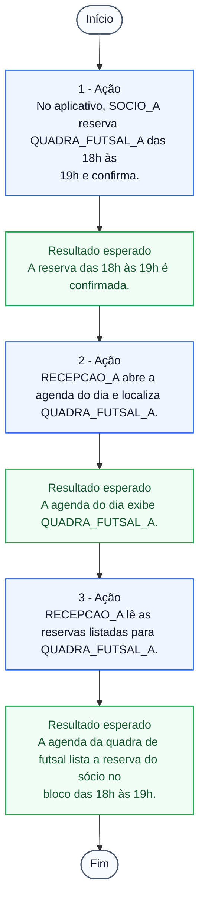

# TC-045 - Reserva criada aparece na agenda da quadra para a recepção

**Status:** NEEDS_REVIEW  
**Prioridade:** HIGH  
**Tipo:** DATA_INTEGRITY  
**Família de cenários:** Agenda do dia

**Base do teste:** DERIVED  
**Tipo primário:** DATA_INTEGRITY  
**Dimensão:** CROSS_REQUIREMENT  
**Adequação à automação:** MEDIUM  
**Prontidão para automação:** NEEDS_POLICY  
**Camada:** UI  
**Pendências:** UNRESOLVED_PERMISSION, MISSING_SELECTOR  
**Perguntas:** Q-009

## Objetivo
Verificar a ligação entre a reserva do sócio e a agenda do dia consultada pela recepção.

## Pré-condições
- SOCIO_A é sócio ativo com sessão aberta e sem reservas futuras
- RECEPCAO_A tem acesso ao aplicativo
- QUADRA_FUTSAL_A está livre das 18h às 19h no dia consultado

## Dados de teste
- **SOCIO_A:** sócio ativo sem reservas futuras
- **RECEPCAO_A:** usuário da recepção com sessão aberta
- **QUADRA_FUTSAL_A:** quadra de futsal livre das 18h às 19h

## Passos
| # | Ação | Resultado esperado | Esclarecimento |
|---:|---|---|:---:|
| 1 | No aplicativo, SOCIO_A reserva QUADRA_FUTSAL_A das 18h às 19h e confirma. | A reserva das 18h às 19h é confirmada. | Não |
| 2 | RECEPCAO_A abre a agenda do dia e localiza QUADRA_FUTSAL_A. | A agenda do dia exibe QUADRA_FUTSAL_A. | Não |
| 3 | RECEPCAO_A lê as reservas listadas para QUADRA_FUTSAL_A. | A agenda da quadra de futsal lista a reserva do sócio no bloco das 18h às 19h. | Não |

## Pós-condições
- Reserva visível na agenda

## Limpeza
- Cancelar a reserva

## Restauração de estado
SELF_CLEANING — o próprio caso limpa (ver Limpeza)

## Rastreabilidade
- Requisitos: REQ-002, REQ-006
- Coverage points: CP-003, CP-017
- Fontes: `sources/prd.md` (Requisitos, item 1 (linha 7)), `sources/prd.md` (Requisitos, item 5 (linha 11)), `sources/prd.md` (Requisitos, itens 1 e 5 (linhas 7 e 11))

## Artefato JSON
`test-cases/TC-045.json`

## Fluxo do Teste

