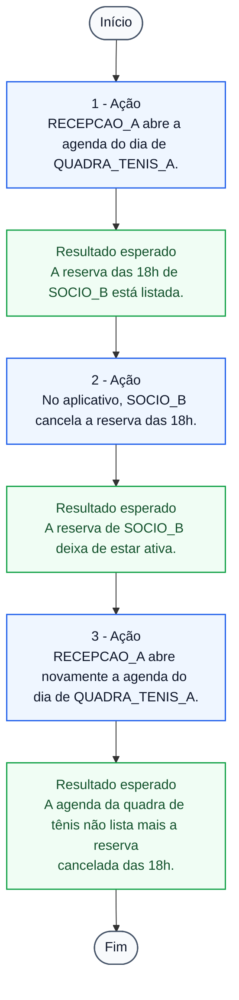

# TC-046 - Reserva cancelada some da agenda do dia

**Status:** NEEDS_REVIEW  
**Prioridade:** HIGH  
**Tipo:** DATA_INTEGRITY  
**Família de cenários:** Agenda do dia

**Base do teste:** DERIVED  
**Tipo primário:** DATA_INTEGRITY  
**Dimensão:** CROSS_REQUIREMENT  
**Adequação à automação:** MEDIUM  
**Prontidão para automação:** NEEDS_POLICY  
**Camada:** UI  
**Pendências:** AMBIGUOUS_POLICY, UNRESOLVED_PERMISSION, BLOCKING_QUESTION  
**Perguntas:** Q-001, Q-009

## Objetivo
Verificar que a agenda da recepção acompanha o cancelamento.

## Pré-condições
- SOCIO_B é sócio ativo com reserva futura em QUADRA_TENIS_A às 18h do dia consultado, com grande antecedência
- RECEPCAO_A tem acesso ao aplicativo

## Dados de teste
- **SOCIO_B:** titular da reserva das 18h
- **RECEPCAO_A:** usuário da recepção com sessão aberta
- **QUADRA_TENIS_A:** quadra de tênis com reserva às 18h

## Passos
| # | Ação | Resultado esperado | Esclarecimento |
|---:|---|---|:---:|
| 1 | RECEPCAO_A abre a agenda do dia de QUADRA_TENIS_A. | A reserva das 18h de SOCIO_B está listada. | Não |
| 2 | No aplicativo, SOCIO_B cancela a reserva das 18h. | A reserva de SOCIO_B deixa de estar ativa. | Não |
| 3 | RECEPCAO_A abre novamente a agenda do dia de QUADRA_TENIS_A. | A agenda da quadra de tênis não lista mais a reserva cancelada das 18h. | Não |

## Pós-condições
- Agenda sem a reserva

## Limpeza
- Nenhum

## Restauração de estado
REQUIRES_FIXTURE_RESET — o harness deve reiniciar as fixtures de Dados de teste antes do próximo caso

## Rastreabilidade
- Requisitos: REQ-004, REQ-006
- Coverage points: CP-012, CP-017
- Fontes: `sources/prd.md` (Requisitos, item 3 (linha 9)), `sources/prd.md` (Requisitos, item 5 (linha 11)), `sources/prd.md` (Requisitos, itens 3 e 5 (linhas 9 e 11))

## Artefato JSON
`test-cases/TC-046.json`

## Fluxo do Teste

