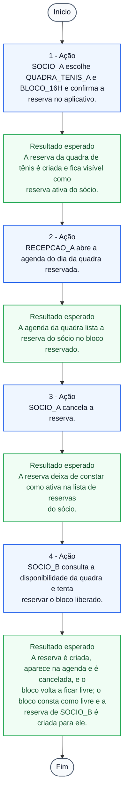

# TC-047 - Jornada: reservar, conferir na agenda, cancelar e liberar o bloco

**Status:** NEEDS_REVIEW  
**Prioridade:** HIGH  
**Tipo:** E2E  
**Família de cenários:** Jornadas

**Base do teste:** E2E  
**Tipo primário:** E2E  
**Dimensão:** E2E  
**Adequação à automação:** MEDIUM  
**Prontidão para automação:** NEEDS_POLICY  
**Camada:** UI  
**Pendências:** AMBIGUOUS_POLICY, MISSING_SELECTOR, BLOCKING_QUESTION  
**Compõe:** TC-001, TC-045, TC-011, TC-012  
**Perguntas:** Q-001

## Objetivo
Verificar o ciclo de vida completo de uma reserva ligando reserva, agenda e cancelamento.

## Pré-condições
- SOCIO_A e SOCIO_B são sócios ativos sem reservas futuras
- RECEPCAO_A tem acesso ao aplicativo
- QUADRA_TENIS_A está livre em BLOCO_16H de uma data futura

## Dados de teste
- **SOCIO_A:** sócio que reserva e cancela
- **SOCIO_B:** outro sócio que reserva o bloco liberado
- **RECEPCAO_A:** usuário da recepção
- **QUADRA_TENIS_A:** quadra de tênis livre em BLOCO_16H
- **BLOCO_16H:** bloco das 16h às 17h de uma data futura, com grande antecedência

## Passos
| # | Ação | Resultado esperado | Esclarecimento |
|---:|---|---|:---:|
| 1 | SOCIO_A escolhe QUADRA_TENIS_A e BLOCO_16H e confirma a reserva no aplicativo. | A reserva da quadra de tênis é criada e fica visível como reserva ativa do sócio. | Não |
| 2 | RECEPCAO_A abre a agenda do dia da quadra reservada. | A agenda da quadra lista a reserva do sócio no bloco reservado. | Não |
| 3 | SOCIO_A cancela a reserva. | A reserva deixa de constar como ativa na lista de reservas do sócio. | Não |
| 4 | SOCIO_B consulta a disponibilidade da quadra e tenta reservar o bloco liberado. | A reserva é criada, aparece na agenda e é cancelada, e o bloco volta a ficar livre; o bloco consta como livre e a reserva de SOCIO_B é criada para ele. | Não |

## Pós-condições
- BLOCO_16H reservado por SOCIO_B

## Limpeza
- Cancelar a reserva de SOCIO_B

## Restauração de estado
SELF_CLEANING — o próprio caso limpa (ver Limpeza)

## Rastreabilidade
- Requisitos: REQ-001, REQ-002, REQ-006, REQ-004
- Coverage points: CP-001, CP-003, CP-017, CP-012, CP-013
- Fontes: `sources/prd.md` (Objetivo (linha 4)), `sources/prd.md` (Requisitos, item 1 (linha 7)), `sources/prd.md` (Requisitos, item 5 (linha 11)), `sources/prd.md` (Requisitos, itens 1 e 5 (linhas 7 e 11)), `sources/prd.md` (Requisitos, item 3 (linha 9)), `sources/prd.md` (Requisitos, itens 1, 3 e 5 (linhas 7, 9 e 11))

## Artefato JSON
`test-cases/TC-047.json`

## Fluxo do Teste

