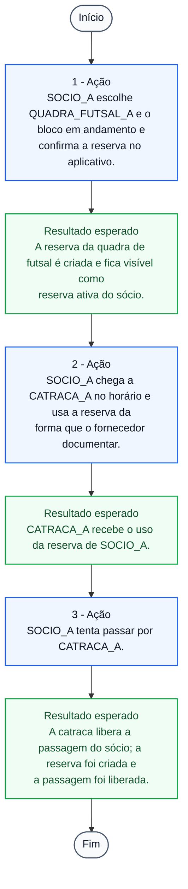

# TC-048 - Jornada: reservar e entrar pela catraca no horário

**Status:** BLOCKED_EXTERNAL_DEPENDENCY  
**Prioridade:** CRITICAL  
**Tipo:** E2E  
**Família de cenários:** Jornadas

**Base do teste:** E2E  
**Tipo primário:** E2E  
**Dimensão:** E2E  
**Adequação à automação:** MANUAL_ONLY  
**Prontidão para automação:** NOT_APPLICABLE  
**Camada:** HARDWARE  
**Pendências:** EXTERNAL_DEPENDENCY_UNAVAILABLE, MISSING_EXECUTION_SURFACE, BLOCKING_QUESTION  
**Compõe:** TC-002, TC-013  
**Perguntas:** Q-002

## Objetivo
Verificar o acesso físico ligado à reserva, dependente da integração com a catraca.

## Pré-condições
- SOCIO_A é sócio ativo com sessão aberta e sem reservas futuras
- QUADRA_FUTSAL_A está livre no bloco em andamento no momento do teste
- CATRACA_A está em operação e a API do fornecedor não tem documentação

## Dados de teste
- **SOCIO_A:** sócio ativo sem reservas futuras
- **QUADRA_FUTSAL_A:** quadra de futsal livre no bloco em andamento
- **CATRACA_A:** catraca de acesso às quadras

## Passos
| # | Ação | Resultado esperado | Esclarecimento |
|---:|---|---|:---:|
| 1 | SOCIO_A escolhe QUADRA_FUTSAL_A e o bloco em andamento e confirma a reserva no aplicativo. | A reserva da quadra de futsal é criada e fica visível como reserva ativa do sócio. | Não |
| 2 | SOCIO_A chega a CATRACA_A no horário e usa a reserva da forma que o fornecedor documentar. | CATRACA_A recebe o uso da reserva de SOCIO_A. | Não |
| 3 | SOCIO_A tenta passar por CATRACA_A. | A catraca libera a passagem do sócio; a reserva foi criada e a passagem foi liberada. | Não |

## Pós-condições
- SOCIO_A dentro da área das quadras

## Limpeza
- Cancelar a reserva

## Restauração de estado
SELF_CLEANING — o próprio caso limpa (ver Limpeza)

## Rastreabilidade
- Requisitos: REQ-001, REQ-005
- Coverage points: CP-002, CP-015
- Fontes: `sources/prd.md` (Objetivo (linha 4)), `sources/prd.md` (Requisitos, item 4 (linha 10)), `sources/prd.md` (Requisitos, itens 1 e 4 (linhas 7 e 10))

## Artefato JSON
`test-cases/TC-048.json`

## Fluxo do Teste

